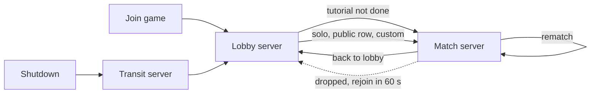
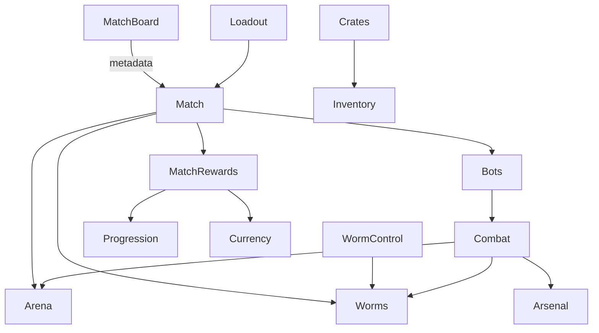

Worm Battlegrounds is built on **ume** (the code folder, `worm-battlegrounds-game/`) and **UmeGui** (the gui folder,
`worm-battlegrounds-gui/`). This page fixes the big choices: which servers exist, how players travel between them, how
a match simulates, and how state reaches clients. The modules themselves are on [[Match modules]] and
[[Lobby & meta modules]], their guis on [[Guis]], every saved key, data row and remote on [[Data & networking]]. The
order to build it all is the [[Roadmap]].

## Places, maps and servers

One Roblox place (`worm-battlegrounds.rbxl`) with three **maps** in ume's place loader. A map decides which staged
folders merge into the game and which modules run (`DisabledModules`).

| Map id | Servers | Who's there | Runs |
|---|---|---|---|
| `Lobby` | Public servers, filled by Roblox's own matchmaking | Everyone who joins the game | The lobby screen, match board, party, loadout, crates, shop |
| `Match` | One **reserved server per match**, made by `I.Teleport` | Only the players the lobby sent (plus bots) | One match at a time: arena, worms, turns, combat, results, rematch |
| `UmeLobby` | Reserved transit servers | Players moved by `I.TeleportToDefaultLobby` (soft shutdown) | Nothing: ume teleports them on to a public `Lobby` server |

:::callout{tone="warning"}
ume's `LobbyId` is **not** the game's lobby. It is a transit map that forwards everyone to the main place (used by
`SoftShutdown`). The game's lobby is the place's `DefaultMapId`, `Lobby`. Keep `LobbyId = "UmeLobby"`.
:::



**Both maps share player data:** every map row uses the **same `ProfileStoreName`**. A player's profile is released by
the server they leave and loaded by the one they arrive in (ProfileStore's session lock handles the hand-off).

### Place loader config

The rows live in `src/core/game_instance/Start/configs/place_loader.lua`. `src/core` is framework-owned, but its
`configs/` are the game's settings: ume's own place loader docs tell games to edit them. Record that in
`.claude/rules/game/practices.md` and re-apply the rows after any ume update.

```luau
DefaultPlaceId = game.PlaceId,

PlaceConfigs = {
	[game.PlaceId] = {
		-- In Studio, the Workspace attribute Ume_StudioMapId = "Match" boots a match to test without teleports
		DefaultMapId = (game:GetService("RunService"):IsStudio() and workspace:GetAttribute("Ume_StudioMapId")) or "Lobby",
		LobbyId = "UmeLobby",

		MapConfigs = {
			["Lobby"] = {
				ProfileStoreName = "UmeTesting_-1", -- the same on every map
				LeaderboardStoreName = "UmeTesting_-1",
				VRSupport = false,
				GameDirs = {
					Workspace_Ume = { "Lobby" }, ReplicatedStorage_Ume = { "Lobby" }, ServerStorage_Ume = { "Lobby" },
					StarterGui = { "Lobby" }, StarterPack = { "Lobby" }, StarterPlayer = { "Lobby" },
					Assets = { "Shared", "Lobby" }, SAssets = { "Lobby" },
				},
				ModulesDirs = { "Ume", "Ume_Data", "Roblox", "Utils", "Main", "Main_Game", "Main_Controllers" },
				DisabledModules = {}, -- ALWAYS_OFF, then the match-only modules (table below)
				LoadingOrder = {},
				ReturnPlaceId = nil,
			},
			-- The same, with "Match" folders, Assets = { "Shared", "Match" }, SAssets = { "Match" },
			-- and DisabledModules = ALWAYS_OFF + the lobby-only modules
			["Match"] = {},
			-- The template's row, unchanged except the store names
			["UmeLobby"] = {},
		},
	},
},
```

`DisabledModules` matches **module folder names exactly**, prefixes included (`2_BackpackPlus`, not `BackpackPlus`).

| List | Modules |
|---|---|
| Off on both maps (`ALWAYS_OFF`) | `2_BackpackPlus`, `Limited`, `CharacterAnimation`, `AFKTeleport`, `Fall_Controller`, `WalkSpeed_Controller`, `GlobalLeaderboard_Controller`, `CountryCode`, `Friends_Controller`, `Group_Controller`, `Premium_Controller`, and ume's `Tool` |
| Off on `Lobby` | `Arena`, `Worms`, `WormControl`, `Combat`, `Match`, `Bots`, `MatchCamera`, `MatchHud`, `MatchRewards` |
| Off on `Match` | `Lobby`, `MatchBoard`, `Party`, `Crates` |

Turning `2_BackpackPlus` off means `0_Console` and `TopBar_Controller` must stop calling `I.BackpackPlus` (both are
the game's own; see [[Lobby & meta modules#Existing modules to change]]).

## Travel between servers

Every trip uses ume's place loader API (server only). The optional gui name shows a teleport screen from
`ServerStorage.Ume.UtilityGuis` while the trip runs.

| Trip | Call | Notes |
|---|---|---|
| Lobby → new match (public row, solo, custom, tutorial) | `I.Teleport(players, MATCH_PLACE_ID, "Match", metadata, "TeleportGui")` | Reserves a server, stores `{ MapId, Metadata }` in MemoryStore for 5 minutes, teleports the group together. The match server reads it as `I.Config.Metadata` |
| Match → lobby (Back to lobby, Leave game, rematch not voted, server closing) | `I.TeleportExternal(players, I.Config.PlaceLoader.DefaultPlaceId, "TeleportGui")` | A plain `TeleportAsync` to the place: Roblox puts the group in a **public** server, which boots the `Lobby` map |
| Lobby → back into a running match (rejoin) | `I.TeleportToServer({ player }, MATCH_PLACE_ID, nil, accessCode, "TeleportGui")` | The access code comes from the profile key `Match.Rejoin` the match server wrote when the player dropped |
| Rematch | No teleport | The match server resets the arena and plays again with whoever voted |
| Server shutting down | `SoftShutdown` (unchanged) | Sends everyone through the transit map to a public lobby |

`MATCH_PLACE_ID` is a `MatchBoard` setting, `game.PlaceId` for now (see the suggestion to move matches to their own
place).

**Edge case:** a rejoin that arrives after the match server closed boots a *new* reserved server whose MemoryStore
entry has expired, so it loads the `Lobby` map in private. The `Lobby` server module checks for that (a reserved
server: `game.PrivateServerId ~= ""` and `game.PrivateServerOwnerId == 0`) and sends everyone to a public lobby.

### Match metadata

What the lobby passes to `I.Teleport` and the match server reads from `I.Config.Metadata` (server only). Its type is
`Match_Metadata` in `Match/_meta/_types.lua`.

| Key | Type | What |
|---|---|---|
| `MatchId` | string | `HttpService:GenerateGUID(false)`, for logs and analytics |
| `Kind` | `"Public"` · `"Solo"` · `"Custom"` · `"Tutorial"` | Sets rewards (custom pays nothing, solo pays a win only) and flow |
| `Mode` | `"Deathmatch"` · `"Duo"` · `"Trio"` · `"Quads"` · `"Teams"` | `Teams` is a custom lobby's team mode |
| `Size` | number | 2, 4, 6 or 8 worms in all, bots included |
| `MapId` | string | An arena id (`PicnicPlains`) |
| `Difficulty` | `"Easy"` · `"Medium"` · `"Hard"` | The bots' difficulty |
| `Roster` | `{ { UserId: number, Team: number?, PartyId: string? } }` | The humans to wait for, with their teams decided in the lobby |
| `AccessCode` | string | Added by ume: the reserved server's code, written into `Match.Rejoin` |

In Studio, `Match` reads `STUDIO_METADATA` from its `Settings.lua` instead, and puts every test player in the roster.

## Simulation

**The server decides everything** (ume's rule: every amount is the server's). Clients send intents (move, aim, fire)
and draw what the server's state says.

### The 2D plane

Everything plays on the X–Y plane at Z = 0; the camera looks along −Z. Worms and projectiles are kept on the plane by a
`PlaneConstraint` (its attachment on an anchored plane part in `Workspace.Ume.Arena`) and kept upright by an
`AlignOrientation`. Decor sits behind the plane (Z below −2) and never collides.

### Terrain: a grid drawn as merged parts

The arena is a **grid of cells** (`CELL_SIZE` = 2 studs, `TERRAIN_DEPTH` = 4 studs deep), held by the server as a Luau
`buffer` (one byte per cell: 0 empty, else a material id).

1. **Load:** `Arena` clones the map template from `ServerStorage.Ume.Assets.Arenas.<MapId>` and **rasterizes** its
   `Terrain` parts into the grid (each part's attribute `Arena_Material`, `Bedrock` for indestructible cells).
2. **Draw:** the grid is split into **chunks** of 16 × 16 cells. Each chunk is **greedy-meshed**: runs of the same
   material merge into as few anchored Parts as possible, so a map is a few hundred parts, not thousands. The server
   builds them in `Workspace.Ume.Arena`; Roblox replicates them, and rejoining players get them for free. A studs
   `Texture` on the front and top faces, offset from the world grid, keeps the studs lined up across merged parts.
3. **Carve:** an explosion clears every cell whose center is within its radius (bedrock stays), then rebuilds only the
   chunks it touched.
4. **Falling blocks:** after a carve, a flood fill from bedrock and the bottom row finds cell groups that float. Each
   group becomes one welded, unanchored debris assembly that falls with Roblox physics; when it settles (or after 4 s)
   its cells are written back into the grid where it landed and those chunks rebuild.

### Worms and projectiles: Roblox physics, server-owned

| Thing | How it moves | Network owner |
|---|---|---|
| Worm, outside its owner's turn | Physics: knockback with `ApplyImpulse`, falls, slides | Server (`SetNetworkOwner(nil)`) |
| Active worm while walking, jumping, flying | Physics driven by its player's client (`LinearVelocity` along X, jump impulses, jetpack force) | **Its player**, so movement feels instant; the server checks it (below) |
| Arc projectiles (Bazooka, grenades, dynamite, cluster bomb, spear, black hole grenade) | Physics: launch velocity from angle and power, wind as a `VectorForce` | Server |
| Steered projectiles (homing missile, spider bomb, snails) | Physics parts steered each step by `LinearVelocity` / `AlignPosition` the server updates | Server |
| Bullets and melee | No part: server `Workspace:Raycast` / overlap queries; clients draw tracers | — |

- **Ownership checks.** While a player owns their worm, the server samples it every Heartbeat: horizontal distance
  walked is charged to stamina (`STAMINA_STUDS` = 20 a turn); a step faster than the worm's top speed, flight without
  a jetpack, or walking past an empty stamina bar snaps the worm back to its last good position and takes ownership
  back. When the player fires, or the turn ends, the server takes ownership back before anything hits.
- **Hits.** Each server step, a physics projectile raycasts from its last position to its new one (fast parts skip
  `Touched`), and explodes at the first terrain or worm hit.
- **Wind** is an integer from −10 to 10 rolled each turn; it adds `Wind × WIND_ACCEL` along X to wind-affected
  projectiles. **Gravity** is `Workspace.Gravity`, set by `Arena` from its settings on match servers.
- **Settle.** After a shot resolves, the turn waits until every worm, projectile and debris is at rest (speed under
  `SETTLE_SPEED` for 0.5 s) or `MAX_SETTLE` seconds pass, then resolves deaths and passes the turn.
- **Hazards.** A worm below the water or lava level, or outside the arena bounds, is knocked out at once. Falls cost 1
  health per stud above `SAFE_FALL_HEIGHT`, 40 at most; an open parachute cancels it.

### Collision groups

Registered by `Arena` on match servers (`PhysicsService`).

| Group | Collides with |
|---|---|
| `Terrain` | Worm, Projectile, Debris |
| `Worm` | Terrain, Projectile, Debris (worms pass through each other) |
| `Projectile` | Terrain, Worm |
| `Debris` | Terrain, Worm, Debris |
| `Ghost` | Nothing |

### Players' own characters

Worms are not Roblox characters. ume's Player module still spawns each player's avatar once
(`INITIAL_CHARACTER_AUTO_LOAD`, a framework setting), so the small `CharacterPark` module anchors it, out of sight, at
`Workspace.Ume.Lobby.BaseSpawn` / `Workspace.Ume.Arena.BaseSpawn`. Chat bubbles and avatar emotes are off
(`Core_Controller`), and voice is wired without positions (`VoiceChat`).

## What reaches clients, and how

ume's rules: a player's private values go in their **Replicator** folder; values other players see go in **attributes
the server writes** (on the `Player`, or on the module's own instances); commands and one-off moments are
**remotes**; times come from `workspace:GetServerTimeNow()`.

| State | Travels as |
|---|---|
| Match phase, round, active worm, turn end time, wind, water level | Attributes on `Workspace.Ume.Match` (`Match` creates it) |
| Each worm's health, team, colour, name, alive, ghost, held item, aim angle | Attributes on its worm model in `Workspace.Ume.Worms` |
| My uses and cooldowns this match, my stamina | My Replicator folder `Match` |
| Coins, diamonds | Currency's Replicator folder (existing) |
| XP and level | Statistic's Replicator folder (`XP`) and Progression's (`Level`) |
| Loadout slots and unlocked slots | My Replicator folder `Loadout` |
| Owned items and copies | Inventory's client data (existing remotes) |
| Party membership | `PartyId` and `PartyLeader` attributes on each `Player` |
| Public match rows and custom rooms | One `Configuration` per row in `ReplicatedStorage.Ume.MatchBoard`, with attributes |
| Terrain, worms, projectiles, debris | Roblox replication of the parts themselves |
| Explosions, hits, tracers, knockouts, emotes | Reliable remotes fired to all, for effects and the kill feed |
| Other players' aim while aiming | Unreliable remote from the aiming client; the server writes the worm's `AimAngle` attribute |

## In the place

```
Workspace.Ume
  Lobby/BaseSpawn                       Lobby map: where avatars are parked
  Arena/  Plane, BaseSpawn, Chunks/, Water, Decor/   Arena (match servers)
  Worms/  <ParticipantId> models        Worms
  Combat/ projectiles, debris           Combat
  Match                                 Match: match-wide attributes
ReplicatedStorage.Ume
  Assets/Skins/<SkinId>                 worm skin models (Shared)
  Assets/Items/<ItemId>                 weapon and utility models held by worms (Shared)
  Assets/Effects/                       explosion, splash and trail templates (Match)
  MatchBoard/<RowId>                    MatchBoard rows (Lobby)
ServerStorage.Ume
  Assets/Arenas/<MapId>                 arena templates (Match): Terrain/, Decor/, Markers/
  UtilityGuis/TeleportGui, LobbyGui     teleport screens for I.Teleport
Lighting.Presets/<Id>                   one lighting preset per arena theme (Lighting Manager)
StarterGui                              every exported gui (both maps)
```

Staged content goes under each container's `PlaceLoader/<Folder>/` (run `.other/create_placeloader_dirs.lua` once,
then add `Lobby`, `Match` and `Shared` folders beside `Default`, which the `Lobby` map replaces). Templates and models
found by a data id are named by that id; everything code clones by name is `PREFAB | Name`.

**An arena template** is a Model named after its map id:

| Child | What |
|---|---|
| `Terrain/` | Anchored parts on the 2-stud grid, each with `Arena_Material` (`Grass`, `Dirt`, `Rock`, `Sand`, `Cloud`, `Bedrock`) |
| `Decor/` | Background props behind the plane, never touched by blasts |
| `Markers/DropZone` | A part: the X range worms can land in, and the height they drop from |
| `Markers/Bounds` | A part: the play area; outside it a worm is out |
| `Markers/Liquid` | A part whose top is the water or lava level, with `Arena_Liquid` = `Water` or `Lava` (none on Fluffy Fallout: the bottom is a void) |

## Module map

Every module the game adds, by folder (ume loads `Utils`, then `Main`, `Main_Game`, `Main_Controllers`). Calls into a
sibling module go in `Start`, never `Init` (ume's structure rule).

| Module | Folder | Runs on | Maps | Page |
|---|---|---|---|---|
| `Arsenal` | `Main_Game` | Global | Both | [[Match modules#Arsenal]] |
| `Arena` | `Main_Game` | Server, Client, Global | Match | [[Match modules#Arena]] |
| `Worms` | `Main_Game` | Server, Client | Match | [[Match modules#Worms]] |
| `WormControl` | `Main_Game` | Server, Client | Match | [[Match modules#WormControl]] |
| `Combat` | `Main_Game` | Server, Client, Global | Match | [[Match modules#Combat]] |
| `Match` | `Main_Game` | Server, Client | Match | [[Match modules#Match]] |
| `Bots` | `Main_Game` | Server | Match | [[Match modules#Bots]] |
| `MatchCamera` | `Main_Game` | Client | Match | [[Match modules#MatchCamera]] |
| `MatchHud` | `Main_Game` | Client | Match | [[Match modules#MatchHud]] |
| `MatchRewards` | `Main_Game` | Server | Match | [[Match modules#MatchRewards]] |
| `Lobby` | `Main_Game` | Server, Client | Lobby | [[Lobby & meta modules#Lobby]] |
| `MatchBoard` | `Main_Game` | Server, Client | Lobby | [[Lobby & meta modules#MatchBoard]] |
| `Party` | `Main_Game` | Server, Client | Lobby | [[Lobby & meta modules#Party]] |
| `Loadout` | `Main_Game` | Server, Client | Both | [[Lobby & meta modules#Loadout]] |
| `Crates` | `Main_Game` | Server, Client, Global | Lobby | [[Lobby & meta modules#Crates]] |
| `Cosmetics` | `Main_Game` | Server, Client, Global | Both | [[Lobby & meta modules#Cosmetics]] |
| `Progression` | `Main_Game` | Server, Client | Both | [[Lobby & meta modules#Progression]] |
| `Shop` | `Main_Game` | Server, Client | Both | [[Lobby & meta modules#Shop]] |
| `Tutorial` | `Main_Game` | Server, Client | Both | [[Lobby & meta modules#Tutorial]] |
| `CharacterPark` | `Utils` | Server | Both | [[Lobby & meta modules#CharacterPark]] |
| `VoiceChat` | `Utils` | Server, Client | Both | [[Lobby & meta modules#VoiceChat]] |
| `Analytics` | `Utils` | Server | Both | [[Lobby & meta modules#Analytics]] |

The template's empty `Main_Game/Game` module becomes `Match` (rename its folder, `_localName`, Settings class and
`I` table), so nothing is left unused.



## Studio testing

Studio can't reserve servers, teleport or use MemoryStore, so:

- **A match in Studio:** set the Workspace attribute `Ume_StudioMapId = "Match"` in the place, then **Test → Clients and
  Servers** with 1–4 players. `Match` builds its roster from `STUDIO_METADATA` and the players present; bots fill the
  rest.
- **The lobby in Studio:** clear the attribute. Starting a match prints its metadata and shows "Matches start only in a
  published game" instead of teleporting (`I.Teleport` returns `false` in Studio).
- **The full trip** (lobby → match → lobby, rejoin, party travel) is tested only in a **published test place** with
  API services on. That is an owner gate on the [[Roadmap]].

::navbox{from="build"}
