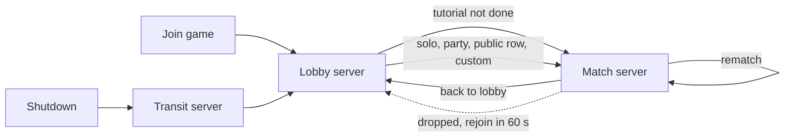
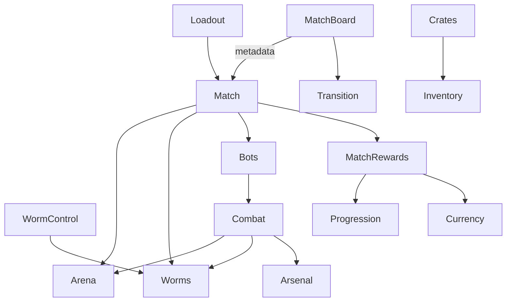

Worm Battlegrounds is built on **ume** (the code folder, `worm-battlegrounds-game/`) and **UmeGui** (the gui folder,
`worm-battlegrounds-gui/`). This page fixes the big choices: which servers exist, how players travel between them, how
a match simulates, and how state reaches clients. The modules themselves are on [[Match modules]] and
[[Lobby & meta modules]], their guis on [[Guis]], every saved key, data row and remote on [[Data & networking]]. The
order they were built in is the [[Roadmap]]. Each module's `_meta/README.md` in the code folder is the source of truth
for its API, settings and place setup; the game's decisions are in `.claude/rules/game/practices.md`.

## Places, maps and servers

Two Roblox places in one experience, **copies of the same place file** (`worm-battlegrounds.rbxl`), saved and
published together: the **lobby place**, where players join, and the **match place, Arena**, whose reserved servers
run the matches. Each boots its own **map** in ume's place loader, picked by its place id, so Roblox's analytics count
the lobby and the matches apart. A map decides which staged folders merge into the game and which modules run
(`DisabledModules`).

| Map id | Booted by | Who's there | Runs |
|---|---|---|---|
| `Lobby` | The lobby place's public servers, filled by Roblox's own matchmaking | Everyone who joins the game | The lobby screen, match board, party, loadout, crates, shop |
| `Match` | The match place, Arena: **one reserved server per match**, made by `I.Teleport` | Only the players the lobby sent (plus bots) | One match at a time: arena, worms, turns, combat, results, rematch |
| `Studio` | Studio playtests only | The test players | Both maps' folders and modules on one server (see [[#Studio testing]]) |
| `UmeLobby` | Reserved transit servers | Players moved by `I.TeleportToDefaultLobby` (soft shutdown) | Nothing: ume teleports them on to a public `Lobby` server (`ReturnPlaceId` is the lobby place) |

:::callout{tone="warning"}
ume's `LobbyId` is **not** the game's lobby. It is a transit map that forwards everyone to the main place (used by
`SoftShutdown`). The game's lobby is the lobby place's `Lobby` map. Keep `LobbyId = "UmeLobby"`.
:::



**Both places share player data:** every map row uses the **same `ProfileStoreName`**. A player's profile is released
by the server they leave and loaded by the one they arrive in (ProfileStore's session lock handles the hand-off). A
match server counts a player as arrived only once their data and client have loaded (`I.Player.Valid`).

### Place loader config

The rows live in `src/core/game_instance/Start/configs/place_loader.lua`. `src/core` is framework-owned, but its
`configs/` are the game's settings: ume's own place loader docs tell games to edit them. Re-apply the rows after any
ume update.

- `LOBBY_PLACE_ID` and `MATCH_PLACE_ID` name the two places; `DefaultPlaceId` is the lobby place, and each place's
  `DefaultMapId` is its map. MatchBoard's `MATCH_PLACE_ID` setting holds the same match place id.
- Every map loads the `Default` folders (shared by both) plus its own: `Lobby` adds `Lobby`, `Match` adds `Match`,
  and `Studio` adds both. Assets also load `Shared`.
- `DisabledModules` is `ALWAYS_OFF` plus the other map's modules. It matches **module folder names exactly**,
  prefixes included (`2_BackpackPlus`, not `BackpackPlus`).

| List | Modules |
|---|---|
| Off on every map (`ALWAYS_OFF`) | `2_BackpackPlus`, `Limited`, `CharacterAnimation`, `AFKTeleport`, `Fall_Controller`, `WalkSpeed_Controller`, `GlobalLeaderboard_Controller`, `CountryCode`, `Friends_Controller`, `Group_Controller`, `Premium_Controller`, and ume's `Tool` |
| Off on `Lobby` (`MATCH_ONLY`) | `Arena`, `Worms`, `WormControl`, `Combat`, `Match`, `Bots`, `MatchCamera`, `MatchHud`, `MatchRewards` |
| Off on `Match` (`LOBBY_ONLY`) | `Lobby`, `MatchBoard`, `Party`, `Crates` |

`0_Console` and `TopBar_Controller` no longer call `I.BackpackPlus` (see
[[Lobby & meta modules#Existing modules to change]]).

## Travel between servers

Every trip uses ume's place loader API (server only), and every one shows the game's teleport card: the server names
the destination with `I.Transition.SetDestination` right before it, the `TeleportGui` card slides down over the
screen, Roblox carries it through the teleport, and the next server's ReplicatedFirst script
(`src/replicated_first/Transition.client.lua`) keeps it up until the player's client has started, then slides it off.
Joins from the website show the place's own loading screen instead.

| Trip | Call | Card |
|---|---|---|
| Lobby → new match (public row, solo, party, custom, tutorial) | `I.Teleport(players, MATCH_PLACE_ID, "Match", metadata, "TeleportGui")`: reserves a server, stores `{ MapId, Metadata }` in MemoryStore for 5 minutes, teleports the group together. The match server reads it as `I.Config.Metadata` | "Heading to Picnic Plains…" (and the map's `Thumbnail`, when it has one) |
| Match → lobby (Back to lobby, Leave, rematch not voted, a match that can't play) | `I.TeleportExternal(players, I.Config.PlaceLoader.DefaultPlaceId, "TeleportGui")`: Roblox puts the group in a **public** lobby server | "Back to the lobby…" |
| Lobby → back into a running match (rejoin) | `I.TeleportToServer({ player }, MATCH_PLACE_ID, nil, accessCode, "TeleportGui")`, with the access code the match server wrote into the profile key `Match.Rejoin` when the player dropped | "Back to your match…" |
| Rematch | No teleport: the match server reloads the arena and plays again with whoever voted | |
| Server shutting down | `SoftShutdown` (unchanged): everyone through the transit map to a public lobby | |

**Edge case:** a rejoin that arrives after the match server closed boots a *new* reserved server whose MemoryStore
entry has expired, so it loads the `Lobby` map in private. The `Lobby` server module checks for that (a reserved
server: `game.PrivateServerId ~= ""` and `game.PrivateServerOwnerId == 0`) and sends everyone to a public lobby.

### Match metadata

What the lobby passes to `I.Teleport` and the match server reads from `I.Config.Metadata` (server only). Its type is
`Match_Metadata` in `Match/_meta/_types.lua`.

| Key | Type | What |
|---|---|---|
| `MatchId` | string | `HttpService:GenerateGUID(false)`, for logs and analytics |
| `Kind` | `"Public"` · `"Solo"` · `"Party"` · `"Custom"` · `"Tutorial"` | Sets rewards (custom and tutorial pay no coins, solo pays a win only, party pays like a public deathmatch) and flow |
| `Mode` | `"Deathmatch"` · `"Duo"` · `"Trio"` · `"Quads"` · `"Teams"` | `Teams` is a custom lobby's team mode (two teams); a party match is `Deathmatch` |
| `Size` | number | 2 to 8 worms in all, bots included |
| `MapId` | string | An arena id (`PicnicPlains`, `Desert`) |
| `Difficulty` | `"Easy"` · `"Medium"` · `"Hard"` · `"Tutorial"` · `"None"` | The bots' difficulty; `None` is a party match without bots |
| `Roster` | `{ { UserId: number, Team: number?, PartyId: string? } }` | The humans to wait for, with their teams decided in the lobby |
| `AccessCode` | string | Added by ume: the reserved server's code, written into `Match.Rejoin` |

Custom matches and party matches with `None` seat no bots; every other kind fills empty seats with bots.

## Simulation

**The server decides everything** (ume's rule: every amount is the server's). Clients send intents (move, aim, fire)
and draw what the server's state says.

### The 2D plane

Everything plays on the X–Y plane at Z = 0; the camera looks along −Z. `Arena`'s `Load` makes an invisible `Plane`
part at the Bounds marker's center with a `Plane` attachment whose axis runs along Z; every worm's `PlaneConstraint`
uses it (`I.Arena.GetPlane()`), and an `AlignOrientation` keeps worms upright, facing ±X. Decor sits behind the plane
and never collides.

### Terrain: authored parts carved by CSG

- **Maps are authored parts**, built like a hand-made map: long parts for the shapes, smaller ones for details, in
  SmoothPlastic with MaterialService's `2022 Stud` variant. Never Roblox Terrain, never a grid of cells. They're made
  in **MapLab**, the game home's map kit (outside this repo): the land drawn as a picture on the 1-stud grid, built
  into parts, props built from parts, validated, and exported into the arena templates once the owner approves.
- **Blasts carve voxel craters with CSG:** `Arena.Carve` subtracts a stepped circle running along Z from every terrain
  part it touches (`GeometryService:SubtractAsync`, one box per row of the 1-stud squares whose centers are within the
  radius, `CARVE_CELL` 1), lined up with the maps' grid, so craters step like voxels; `SplitApart` keeps every loose
  piece its own part. The terrain stays long parts; only the cut is stepped. A crater can reach half a stud past the
  radius at its edge. A cut takes about 10 to 140 ms in Studio.
- **Ground is bedrock on the floor:** each island's bottom layer (Y 4 to 8 on Picnic Plains and Desert) carries
  `Arena_Indestructible`, a name from before blasts could cut it. Blasts cut it like any terrain, so an island can be
  blasted down to the liquid. A bedrock piece holds up whatever touches it while its bottom still reaches the map's
  floor (the bottom of its lowest bedrock, `Loader.GetFloor`, within `CONTACT_MARGIN` 0.15).
- **Floating ledges** carry `Arena_Floats` on every part: a cut-off group of them stays up while its floating parts
  cover `FLOAT_MIN_AREA` (24 square studs on the plane); smaller crumbs fall.
- **Falling ground:** after a carve, every group of pieces that no longer reaches the ground or floats is welded, falls
  with server physics, and anchors again where it lands (below `SETTLE_SPEED` 0.5 studs/s for 0.5 s, or after 4 s).
  Debris that falls 20 studs below the bounds is removed.
- **Props** (trees, bushes, rocks in a map's `Decor`) are `Arena_Prop` Models built from parts, never collidable for
  worms or shots. A blast cuts its hole through them with the same stepped cutter; the pieces still joined to the
  prop's base stand, the rest fly off at 35 studs/s with a spin, lie 3 s and fade over 1 s. A prop whose ground under
  its trunk is gone falls whole. A one-part prop (a mesh) is thrown whole.
- **Liquids** (water, lava) are the only grid: half-stud cells stepped at 8 fps, drawn as merged rectangles in
  `2022 Small Stud`, so they hop like a brick film. They flow into craters, spill out of broken basins, level out
  (also under debris dipping into them, as if under pressure) and get pushed up by debris landing in them. A calm map
  is a handful of parts. Sudden death raises the map's first liquid marker (`RaiseLiquid`).
- **Load:** `Arena` caches and checks every template in `SAssets.Arenas` once at start, so `Load` clones a ready
  template (Picnic Plains in about 0.2 s, Desert 0.43 s in Studio) and publishes `Arena_Loaded`. Gravity and lighting
  presets per map aren't built yet.

### Worms and projectiles: Roblox physics, server-owned

| Thing | How it moves | Network owner |
|---|---|---|
| Worm, outside its owner's turn | Physics: knockback with `ApplyImpulse`, falls, slides | Server (`SetNetworkOwner(nil)`) |
| Active worm while walking, jumping, flying | Physics driven by its player's client (`LinearVelocity` along X, a jump speed, jetpack climb) | **Its player**, so movement feels instant; the server checks it (below) |
| Arc projectiles (Bazooka, grenades, dynamite, cluster bomb, spear, black hole grenade) | Physics: launch velocity from angle and power, wind along X | Server |
| Steered projectiles (homing missile, spider bomb, snails) | Physics parts the server steers each step | Server |
| Bullets and melee | No part: server raycasts and box overlaps; clients draw tracers | — |

- **Ownership checks.** While a player owns their worm, the server charges sideways movement to the worm's `Stamina`
  attribute (`STAMINA_STUDS` 20 a turn) and compares the worm with where it was up to 0.25 s ago: more than 1.5 × the
  walk speed sideways (or the jump speed up), plus 2 studs of slack, or more than 8 studs on past an empty bar
  (`STAMINA_GRACE`), snaps it back, ends the turn and warns. When the player fires, or the turn ends, the server takes
  ownership back before anything hits.
- **Hits.** Each server step, a physics projectile raycasts from its last position to its new one (fast parts skip
  `Touched`), and bursts at the first terrain or worm hit.
- **Wind** is a whole number from −10 to 10 rolled each turn; it adds `Wind × WIND_ACCEL` (3) along X to
  wind-affected projectiles.
- **Settle.** After a shot resolves, the turn waits until every worm, projectile and debris is at rest (0.5 s under
  `SETTLE_SPEED`) or `MAX_SETTLE` 8 s pass, then resolves knockouts and passes the turn.
- **Hazards.** `I.Arena.GetHazard` along each worm's path every Heartbeat (in liquid-cell steps, so a fast worm can't
  skip through water): in liquid, or beside or below the Bounds marker, the worm is knocked out at once. Falls cost 1
  health per stud above `SAFE_FALL_HEIGHT` 10, 40 at most; an open parachute cancels it.

### Collision groups

Registered by `Arena` at start (`COLLISION_GROUPS`).

| Group | Never collides with |
|---|---|
| `Terrain` | — (terrain and falling debris, which stays in `Terrain`) |
| `Worm` | `Worm`, `Default` (worms pass through each other, avatars and the place's own parts) |
| `Projectile` | `Projectile`, `Default` |
| `Ghost` | Everything |
| `Chip` | Everything but `Terrain` (the chunks a blast throws, on clients only) |

### Players' own characters

Worms are not Roblox characters. ume's Player module still spawns each player's avatar once
(`INITIAL_CHARACTER_AUTO_LOAD`, a framework setting), so the small `CharacterPark` module anchors it at
`PARK_POSITION` 0, −60, 0 (below the arena, above `Fall_Controller`'s −100) and hides it, with its name and the
clothes, hats and face that load later, since Roblox's camera looks at it until a game camera takes over. Chat bubbles
and avatar emotes are off (`Core_Controller`), and voice is wired without positions (`VoiceChat`). The template's
baseplate (`Workspace.Ume.Env`) is moved to ServerStorage when the game starts.

## What reaches clients, and how

ume's rules: a player's private values go in their **Replicator** folder; values other players see go in **attributes
the server writes** (on the `Player`, or on the module's own instances); commands and one-off moments are
**remotes**; times come from `workspace:GetServerTimeNow()`. Worm state is the game's exception: it lives on the worm
model, which bots have too (practices).

| State | Travels as |
|---|---|
| Match phase, round, active worm, turn order, turn end time, wind, drop area | Attributes on `Workspace.Ume.Match` |
| Each participant's name, team, colour, drop spot, connection | A `Configuration` per participant under `…Match.Participants` |
| Each worm's health, team, colour, name, alive, ghost, `CanMove`, `Stamina`, held item, aim (`AimAngle`, `AimPower`, `AimTime`), gear (`Parachute`, `JetpackFuel`) | Attributes on its worm model in `Workspace.Ume.Worms` |
| My items, uses and cooldowns this match | My Replicator folder `Combat` |
| Coins, diamonds | Currency's Replicator folder (existing) |
| XP and level | Statistic's Replicator folder (`XP`) and Progression's (`Level`) |
| Loadout slots and unlocked slots | My Replicator folder `Loadout` |
| Owned items and copies | Inventory's client data (existing remotes) |
| Party membership, level, VIP, whether I'm in a match | `PartyId`, `PartyLeader`, `Level`, `Vip`, `InMatch` attributes on each `Player` |
| Public match rows and custom rooms | One `Configuration` per row in `ReplicatedStorage.Ume.MatchBoard`, with attributes |
| Terrain, worms, projectiles, debris | Roblox replication of the parts themselves |
| Explosions, hits, tracers, knockouts, emotes, teleport destinations | Reliable remotes, for effects, the kill feed and the teleport card |
| The active worm's aim | Unreliable `Combat_Aim` from the aiming client (10 a second); the server writes the worm's aim attributes, which every client draws |

## In the place

```
Workspace.Ume
  ServerStorage_Assets/Arenas/<MapId>   arena templates, authored here; moved to SAssets.Arenas at start
  ReplicatedStorage_Assets/Arsenal/     weapon and utility models (Models/, Projectiles/); moved to Assets.Arsenal
  Arena/  Plane, terrain, liquids, debris   Arena (match servers)
  Worms/  <ParticipantId> models        Worms
  Combat/ projectiles, held weapons, aim and blast effects   Combat
  Match                                 Match: match-wide attributes
  Lobby/                                the lobby stage's worm (Lobby, client)
  Env                                   the template's baseplate, moved out at start
Workspace._Labs.MapLab                  MapLab's build area (HideOnPlay), 3000 studs east of the arena
ReplicatedStorage.Ume
  Assets/Skins/<SkinId>                 worm skin models (only Classic for now)
  Assets/Arsenal/Models/<ItemId>        weapon and utility models, each a RootPart with a Muzzle attachment
  Assets/Arsenal/Projectiles/<ShotId>   shot models (HomingMissile, Snail)
  MatchBoard/<RowId>                    MatchBoard rows (Lobby)
ServerStorage.Ume
  PlaceLoader_Workspace/Lobby/LobbyStage   the lobby's 3D stage (Markers/Camera, Markers/Worm)
  UtilityGuis/TeleportGui, LobbyGui     teleport cards for I.Teleport
ServerStorage.!dump                     scratch and replaced things (the greybox, old models)
StarterGui                              every exported gui (both maps)
```

Staged content goes under each container's `PlaceLoader/<Folder>/` (`Default`, `Shared`, `Lobby`, `Match`).
Templates and models found by a data id are named by that id; everything code clones by name is `PREFAB | Name`.

**An arena template** is a Model named after its map id:

| Child | What |
|---|---|
| `Terrain/` | Anchored parts in `2022 Stud`, grouped by piece (`Island_1`, `Ledge_1`…) and named by layer (`Grass`, `Dirt`, `DarkDirt`, `Stone`, `DarkStone`; `Sand`, `DarkSand`, `Sandstone`, `Clay`…). Bedrock has `Arena_Indestructible`, every ledge part `Arena_Floats` |
| `Decor/` | `Backdrop` (behind the plane, never touched), and the props: `Trees`, `Bushes`, `Rocks`, `Cacti`, each prop an `Arena_Prop` Model |
| `Markers/Bounds` | A part: the play area; beside or below it a worm is out, above is fine |
| `Markers/<Liquid>` | Boxes with `Arena_Liquid` = `Water` or `Lava` (`Sea`, `Lava`, `Oasis`…); the first one is the one sudden death raises |

| Map | Terrain | Decor | Bounds | Liquids |
|---|---|---|---|---|
| `PicnicPlains` | 537 parts: 3 islands, 4 ledges | Backdrop, pines, oaks, birches, bushes, rocks (18 props) | 282 × 114 × 11 at 0, 49, 0 | `Sea`, water, Y −8 to 6.5 |
| `Desert` | 461 parts: 1 island, 2 floating islands | Backdrop (dunes and mesas), 9 cacti, 8 bushes, 5 rocks, 3 palms | 282 × 114 × 11 at 0, 49, 0 | `Lava`, Y −8 to 4; `Oasis`, water, x −30 to 0, Y 16 to 23 |

The maps' sources (`land.png`, `map.json`, Desert's `generate.py`) are in the game home's `assets/models/maps/`,
outside this repo.

## Module map

Every module the game adds, by folder (ume loads `Utils`, then `Main`, `Main_Game`, `Main_Controllers`). Calls into a
sibling module go in `Start`, never `Init` (ume's structure rule).

| Module | Folder | Runs on | Maps | Page |
|---|---|---|---|---|
| `Arsenal` | `Main_Game` | Global | Both | [[Match modules#Arsenal]] |
| `Arena` | `Main_Game` | Server | Match | [[Match modules#Arena]] |
| `Worms` | `Main_Game` | Server, Client | Match | [[Match modules#Worms]] |
| `WormControl` | `Main_Game` | Server, Client | Match | [[Match modules#WormControl]] |
| `Combat` | `Main_Game` | Server, Client, Global | Match | [[Match modules#Combat]] |
| `Match` | `Main_Game` | Server, Client | Match | [[Match modules#Match]] |
| `Bots` | `Main_Game` | Server | Match | [[Match modules#Bots]] |
| `MatchCamera` | `Main_Game` | Client | Match | [[Match modules#MatchCamera]] |
| `MatchHud` | `Main_Game` | Client | Match | [[Match modules#MatchHud]] |
| `MatchRewards` | `Main_Game` | Server | Match | [[Match modules#MatchRewards]] |
| `Lobby` | `Main_Game` | Server, Client | Lobby | [[Lobby & meta modules#Lobby]] |
| `MatchBoard` | `Main_Game` | Server, Client | Lobby | [[Lobby & meta modules#MatchBoard]] |
| `Party` | `Main_Game` | Server, Client | Lobby | [[Lobby & meta modules#Party]] |
| `Loadout` | `Main_Game` | Server, Client | Both | [[Lobby & meta modules#Loadout]] |
| `Crates` | `Main_Game` | Server, Client, Global | Lobby | [[Lobby & meta modules#Crates]] |
| `Cosmetics` | `Main_Game` | Server, Client, Global | Both | [[Lobby & meta modules#Cosmetics]] |
| `Progression` | `Main_Game` | Server | Both | [[Lobby & meta modules#Progression]] |
| `Shop` | `Main_Game` | Server, Client | Both | [[Lobby & meta modules#Shop]] |
| `Tutorial` | `Main_Game` | Server, Client | Both | [[Lobby & meta modules#Tutorial]] |
| `Transition` | `Main_Game` | Server, Client | Both | [[Lobby & meta modules#Transition]] |
| `CharacterPark` | `Utils` | Server | Both | [[Lobby & meta modules#CharacterPark]] |
| `VoiceChat` | `Utils` | Server, Client | Both | [[Lobby & meta modules#VoiceChat]] |
| `ScreenScale` | `Utils` | Client | Both | [[Guis#How guis fit the screen]] |
| `TextCase` | `Utils` | Client | Both | [[Guis#How every gui is made]] |
| `Analytics` | `Utils` | Server | Both | [[Lobby & meta modules#Analytics]] (not built yet) |

The template's empty `Main_Game/Game` module is now `Match`.



## Studio testing

Studio can't reserve servers or use MemoryStore the way a live game does, so:

- **The quick test, the `Studio` map** (the default in Studio): both maps' folders and modules on one server. The
  lobby hands each match to `I.Match.Host` instead of teleporting, and the `InMatch` Player attribute says which half
  a player is in; every screen, camera and hint follows it. Studio saves nothing, so a playtest skips the tutorial
  match and opens on the lobby; the Workspace attribute `StudioTutorial = true` plays it.
- **The real trip:** the Workspace attribute `Ume_StudioMapId = "Lobby"`. The lobby teleports to the match place,
  which a Studio test runs as last saved to Roblox, so **save both places first**. The map and match ride in the
  teleport's data there (a Studio test gives reserved servers no id).
- **The match alone:** `Ume_StudioMapId = "Match"`. `Match` plays `STUDIO_METADATA` (a 4-worm deathmatch on Picnic
  Plains) with every test player, bots filling the rest.
- **A published test** is still the only check for parties, rejoin and two-account flows.

::navbox{from="build"}
