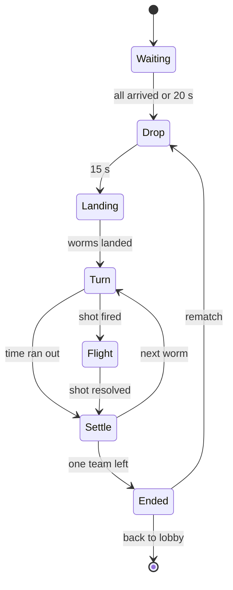

The modules that run on a **match server** (the `Match` map). They live in `src/modules/Main_Game/` of the code folder
and are turned off on the `Lobby` map ([[Architecture#Place loader config]]). Rules for every module: the code folder's
`AGENTS.md` and `.claude/rules/` (`ume/structure.md`, `ume/events.md`, `ume/environments.md`, `luau/*`). What players
see and the numbers come from the game pages: [[Match modes & maps]], [[Controls & platforms]], [[Arsenal]],
[[Match screen]], [[Currencies & crates#Coins from a match]].

## Arsenal

| | |
|---|---|
| Runs on | Global (both maps: the lobby's loadout picker shows uses and cooldowns too) |
| Exposes | `I.G_Arsenal` |
| Data | `Data/Weapons/<ItemId>.lua`, `Data/Utilities/<ItemId>.lua` (shape: [[Data & networking#Arsenal rows]]) |

The combat numbers of the 14 weapons and 6 utilities, keyed by the same ids as their Inventory items. It holds no
state.

- `Get(itemId)` → the row, warns and returns `nil` for an unknown id (ume's cache `Get*` rule).
- `GetAll()`, `IsWeapon(itemId)`, `IsUtility(itemId)`.
- `GetDamage(itemId, distance, isShiny)` → damage at that distance from the blast center: linear from `DamageMax` at
  the center to `DamageEdge` at `BlastRadius`, times `SHINY_DAMAGE_MULTIPLIER` (1.05) when shiny.
- `GetKnockback(class)` → impulse speed for `Small`, `Medium`, `High`, `VeryHigh`, `Extreme` (`KNOCKBACK` setting).
- At start it checks every row has an Inventory item of category `Weapon` or `Utility` (except the always-owned
  Bazooka) and every such item has a row, warning for each mismatch.

**Done when:** `I.G_Arsenal.Get("Dynamite").DamageMax` prints 85 from the command bar, and a missing row warns once
at start.

## Arena

| | |
|---|---|
| Runs on | Server, Client, Global |
| Exposes | `I.Arena` (server), `I.G_Arena` (both: grid queries) |
| World | `Workspace.Ume.Arena` |
| Uses | `I.Dirs.SAssets` (`Arenas`), `I.Lighting`, `PhysicsService` |

Owns the terrain and the arena around it. How the grid, chunks, carving and falling blocks work:
[[Architecture#Terrain: a grid drawn as merged parts]].

**Server handlers** (`Scripts/Server/`):

| Handler | Does |
|---|---|
| `Loader.lua` | `Load(mapId)`: clears the old arena, clones the template's Decor and Markers, rasterizes Terrain into a fresh grid, builds every chunk, places the plane part, the liquid part and `BaseSpawn`, applies the map's lighting preset, sets `Workspace.Gravity`. Registers the collision groups in `Init` |
| `Grid.lua` | The `buffer`, cell ↔ world conversion, `Carve(center, radius)` → cells removed, flood fill for floating groups |
| `Chunks.lua` | Greedy meshing of one chunk into Parts (material colours from `MATERIALS`, the studs `Texture`), rebuilding the chunks a carve touched |
| `Debris.lua` | Turns floating groups into falling welded assemblies (`Debris` group, server-owned) and writes them back into the grid when they settle |
| `Liquid.lua` | The water or lava level, raising it each turn in sudden death (`RaiseLiquid(cells)`), and the `LiquidLevel` attribute |

**Server API (`I.Arena`):** `Load(mapId)`, `Carve(center: Vector3, radius: number)`, `RaiseLiquid(cells)`,
`GetDropZone()` → X min, X max and drop height, `GetBounds()`, `GetLiquid()` → level and kind, `IsOut(position)` → `false` or
the cause (`Water`, `Lava`, `Fell`), `IsSettled()` (no debris moving).

**Global API (`I.G_Arena`):** `IsSolid(position)`, `GroundBelow(position)` → the top of the first solid ground
below, used by bots (server, from the grid) and drop markers (client, a raycast against the replicated terrain
parts). Clients never carve.

**Client:** liquid surface effects (waves, lava glow), debris dust on carve, and the arena backdrop (a sky image far
behind the plane, from the map row).

**Settings:** `CELL_SIZE` 2, `TERRAIN_DEPTH` 4, `CHUNK_CELLS` 16, `GRAVITY` (start at 120, tune), `MATERIALS` (id →
colour, Material, indestructible), `DEBRIS_SETTLE_TIME` 4.

**Done when:** a Studio match on the greybox Picnic Plains shows the terrain as studded merged parts (a few hundred,
not thousands: count them), `I.Arena.Carve(Vector3.new(0, 10, 0), 6)` from the command bar cuts a round hole, and a
bridge cut at both ends falls and rejoins the ground.

## Worms

| | |
|---|---|
| Runs on | Server, Client |
| Exposes | `I.Worms` (server), `I.Worms` (client: lookups) |
| World | `Workspace.Ume.Worms`, one Model per participant |
| Uses | `I.Arena`, `I.Cosmetics` (equipped skin), `I.Sound`, `I.Haptic` |

The worm bodies: spawning, health, damage, death, ghosts, and how they look.

- **A worm** is a Model named by its participant id (`P_<UserId>` for players, `B_<n>` for bots): an invisible
  `Ball` root part (2.6 studs across, `Worm` collision group, custom friction), the skin model cloned from
  `Assets.Skins.<SkinId>` welded on and massless, a `PlaneConstraint` and an `AlignOrientation` (upright, facing left
  or right), an `AnimationController` with an `Animator`, and the held item's model from `Assets.Items.<ItemId>`.
- **Attributes** (others read them): `ParticipantId`, `UserId` (0 for bots), `DisplayName`, `Team`, `Color`,
  `Health`, `MaxHealth`, `Alive`, `Ghost`, `IsBot`, `Facing` (−1 or 1), `HeldItem`, `AimAngle`, `Shiny` (skin),
  `Vip`.
- **Server API (`I.Worms`):** `Spawn(participant, position)`, `Get(participantId)` → model, `GetAll()`,
  `GetAlive()`, `Damage(participantId, amount, sourceId?, itemId?)`, `Heal(participantId, amount)` (never above
  `MAX_HEALTH` 200), `Knockback(participantId, impulse: Vector3, sourceId?)`, `Kill(participantId, cause, sourceId?)`,
  `SetOwner(participantId, player?)` (network ownership), `IsSettled()`, `Clear()`.
- **Each Heartbeat** (server): checks `I.Arena.IsOut` for every alive worm, tracks the highest point of each fall and
  applies fall damage on landing (1 per stud above `SAFE_FALL_HEIGHT`, at most 40; none while a parachute is open),
  and keeps the last attacker of each worm this turn for kill credit.
- **Death:** `Alive = false`, `Ghost = true`, the body becomes a see-through ghost in the `Ghost` group that floats
  up a few studs; publishes `Worms_Died (participantId, cause, killerId?, itemId?)`.
- **Client:** clones the `WormTag` billboard onto each worm (name in team colour, gold for VIP, health number and
  bar, the active marker and timer above the active worm for everyone but its owner), plays animations (`Idle`,
  `Walk`, `Jump`, `Fall`, `Aim`, `Hurt`, `Emote`) from the skin row's ids, pops damage numbers when the
  `DamageNumbers` setting is on, hurt sounds and voice lines.

**Settings:** `MAX_HEALTH` 200, `SAFE_FALL_HEIGHT` 10 (a proposal), `MAX_FALL_DAMAGE` 40, `ROOT_SIZE` 2.6.

**Done when:** in a Studio match each test player has a worm on the plane that never leaves Z = 0, health shows over
its head, `I.Worms.Damage("P_<id>", 50)` drops the bar to 150, and a worm pushed into the water turns into a ghost
and prints `Worms_Died … Water`.

## WormControl

| | |
|---|---|
| Runs on | Server, Client |
| Exposes | `I.WormControl` (server: turn start/end hooks) |
| Uses | `I.Worms`, `I.Match`, `I.Platform`, `ContextActionService` |

Moving the active worm, and the movement utilities' effects.

- **Client, during my turn:** binds move (:kbd[A] :kbd[D], arrows, left stick, the on-screen ◀ ▶), jump (:kbd[Space],
  :kbd[A] on a pad, the jump button) at `Enum.ContextActionPriority.High`, sinking them while my turn runs, unbinding
  when it ends. My client owns my worm then: walking sets a `LinearVelocity` along X at `WALK_SPEED`, jumping applies
  an upward impulse (unlimited jumps), and a short step-up push climbs one-cell ledges. The stamina bar reads my
  Replicator `Match.Stamina` and stops walking at 0.
- **Server:** at turn start gives the active player ownership (`I.Worms.SetOwner`) and fills stamina; each Heartbeat
  charges horizontal distance to stamina and checks speed (the checks in [[Architecture#Worms and projectiles: Roblox physics, server-owned]]); takes
  ownership back on fire, turn end or a failed check.
- **Utility effects** (`ApplyEffect(participantId, effect)`, called by Combat): `Jetpack` (client-driven upward
  `VectorForce` with `JETPACK_FUEL` seconds of fuel, 20% more when shiny; the server allows flight only while fuel
  lasts), `Speed` (walk speed ×`SPEED_MULTIPLIER` for the turn, 10% more when shiny), `LowGravity` (a counter-gravity
  `VectorForce` of `LOW_GRAVITY_SCALE` for the turn, 10% stronger when shiny), `Parachute` (caps falling speed at
  `PARACHUTE_FALL_SPEED`, 20% slower when shiny, until landing; no fall damage).

**Settings:** `WALK_SPEED` 8, `JUMP_IMPULSE`, `STAMINA_STUDS` 20, `STEP_HEIGHT` 2, `JETPACK_FUEL` 3,
`SPEED_MULTIPLIER` 1.5, `LOW_GRAVITY_SCALE` 0.4, `PARACHUTE_FALL_SPEED` 6. Whether the Speed potion also stretches
stamina is asked on [[Arsenal]]; until answered it stretches stamina by the same 1.5.

**Done when:** on my turn my worm walks and jumps with no delay, stops after about 20 studs, and a command-bar
teleport of my worm on my client snaps it back within a second with a warning in the server output.

## Combat

| | |
|---|---|
| Runs on | Server, Client, Global |
| Exposes | `I.Combat` (server), `I.G_Combat` (both: launch math) |
| World | `Workspace.Ume.Combat` (projectiles) |
| Uses | `I.G_Arsenal`, `I.Arena`, `I.Worms`, `I.WormControl`, `I.Match`, `I.Sound`, `I.CameraShake` (client) |

Everything between "fire" and "the shot is over": checking the request, uses and cooldowns, running the weapon,
explosions, damage, knockback and kill credit.

**The fire pipeline (server):**

1. `Combat_Fire (player, itemId, angle, power, target?)` arrives. Checks: the player's worm is the active one, the
   phase is `Turn`, the item is the Bazooka or in their match loadout, uses left and no cooldown, `angle` is finite,
   `power` is 0–1. Anything else is dropped (ume's Network already rejects bad types and NaN).
2. Takes a use, starts the cooldown, takes the worm's ownership back, publishes `Combat_ShotFired` (Match moves to
   `Flight`).
3. Runs the weapon's **behavior** (below). Each behavior ends by calling `Explode` and/or `Hit`.
4. When every projectile, bomblet and snail is done, publishes `Combat_ShotResolved (participantId, damageDealt)`.

**Utilities:** `Combat_UseUtility (player, itemId)` checks the same way, takes a use, and applies it: `Bandage` +40,
`Medkit` +100 (45 and 110 shiny) through `I.Worms.Heal`; the others through `I.WormControl.ApplyEffect`. Using a
utility never ends the turn.

**`Explode(center, radius, itemId, sourceId)`:** carves the terrain (`I.Arena.Carve`), finds worms in the radius
(`GetPartBoundsInRadius` on root parts), deals `I.G_Arsenal.GetDamage` to each, pushes each away from the center (plus
an upward bias) with the weapon's knockback class, records the attacker, fires `Combat_Explosion` to all.

**`Hit(participantId, damage, impulse, itemId, sourceId)`:** the same for bullets and melee, with no carve (bullets
carve one cell where they hit terrain).

**Behaviors** (`Scripts/Server/Behaviors/<Kind>.lua`, one file per kind; each weapon row names its kind):

| Kind | Weapons | How it runs |
|---|---|---|
| `Rocket` | Bazooka, Spartan spear | Physics part launched at `angle` with speed from `power`; wind force; raycast each step; the Bazooka explodes on first contact; the spear hits every worm along its path (each once) and sticks into the terrain |
| `Bouncer` | Grenade, Dynamite, Cluster bomb, Variety grenade | Physics part with bounce (`Elasticity`); Grenade explodes after its `Fuse` (3 s); Dynamite and Cluster bomb on first contact; Cluster then scatters 5 `Bomblet` parts that explode on contact; Variety grenade deals 50, then spawns 4 `Snail`s |
| `Snail` | Variety grenade's snails | 4 steered parts, each in its own direction (down-left, down-right, left, right), eating cells (`Carve` radius 2) as they crawl; each hits a worm it touches 5 per hit, 8 hits at most, 40 in all |
| `Crawler` | Spider bomb | Thrown like a grenade; on landing crawls along the terrain surface and up walls toward the nearest enemy for 5 s, then explodes |
| `Homing` | Homing missile | Needs `target`: flies up for 1 s with wind, then steers toward the target at constant speed, wind no longer counts; explodes on contact |
| `Roller` | Black hole grenade | Released at the worm's feet, rolls forward (`Facing`) along the ground and hops over bumps; never explodes on its own; a second `Combat_Detonate` from its owner (or the end of `MAX_ROLL_TIME`) bursts it: radius 14, 100 to 25, a black hole effect |
| `Hitscan` | Shotgun, Uzi, Minigun | Raycasts from the muzzle: Shotgun 5 pellets in a `Spread` cone at once; Uzi 5 and Minigun 20 in a burst `BurstInterval` apart, each with a small knockback; fires `Combat_Tracer` for each |
| `Melee` | Baseball bat, One Punch | A box overlap in front of the worm in the aim direction; the first worm hit takes the damage and a `VeryHigh` (bat) or `Extreme` (punch, steeper upward) knockback |

**Client:** explosion, splash and tracer effects from the remotes (templates in `Assets.Effects`), the black hole
effect, camera shake scaled by distance to my camera (`I.CameraShake`), a haptic on my worm's hits (`I.Haptic`),
projectile trails (attachments added to the replicated parts when they appear).

**Global (`I.G_Combat`):** `GetLaunchVelocity(itemId, angle, power)` and `PredictArc(origin, velocity, wind, seconds)`,
shared by the aim line, bots and the server so they agree.

**Match state the server keeps** (session, reset each match): uses left and cooldown per participant and item,
written to the owner's Replicator `Match` folder as `Uses_<ItemId>` and `Cooldown_<ItemId>` (own turns left).

**Done when:** each of the 14 weapons and 6 utilities does what its [[Arsenal]] row says in a Studio match against
a bot, uses and cooldowns count down in the loadout bar, and the kill feed names the right weapon for each knockout.

## Match

| | |
|---|---|
| Runs on | Server, Client |
| Exposes | `I.Match` (server, client) |
| World | `Workspace.Ume.Match` (attributes), the template's `Main_Game/Game` renamed |
| Uses | `I.Config.Metadata`, `I.Arena`, `I.Worms`, `I.WormControl`, `I.Combat`, `I.Bots`, `I.Loadout`, `I.Cosmetics`, `I.Team`, `I.Player`, `I.Notify`, `I.TeleportExternal` |

The match: who plays, the phases, the turns, and how it ends.

**Server handlers** (`Scripts/Server/`):

| Handler | Does |
|---|---|
| `Roster.lua` | Builds participants from the metadata (or `STUDIO_METADATA`): humans from `Roster`, bots to fill `Size`. Each participant: `Id`, `UserId`, `Name`, `Team`, `Color`, `IsBot`, `Loadout` (from `I.Loadout.GetMatchLoadout`; bots from `Bots`), `Skin`, `Shiny`. Team modes create Roblox teams (`I.Team.Create`, Red, Blue, Green, Yellow) so the player list and team chat follow; free-for-all gives each participant one of `FFA_COLORS`. Kicks anyone not in the roster back to the lobby |
| `Phases.lua` | The state machine above. `Waiting`: up to `WAIT_FOR_PLAYERS` 20 s; missing public players become bots, missing custom players are dropped. `Drop`: 15 s to pick a landing spot (`Match_PickDrop`; bots pick at random, spread apart), `DropX` on each worm's participant; then worms spawn at the drop height with parachutes open. `Ended`: placements, `Match_Ended`, the results, the rematch vote |
| `Turns.lua` | Turn order team by team (random team order, members rotating inside each team, skipping dead and away worms), the 15 s timer (`TurnEndsAt` = server time + 15), a new wind each turn, rounds (a round ends when the order wraps), sudden death from round `SUDDEN_DEATH_ROUND` (the liquid rises `SUDDEN_DEATH_RISE` cells each turn), settle, then the next turn |
| `Placement.lua` | Records the order worms go out; places the last team (or worm) standing first; team modes give every member the team's place. A leaver is placed last among those still alive when they leave |
| `Connection.lua` | Leave game (`Match_Leave`): kill the worm (ghost), place it, teleport the player to the lobby. Disconnect: the worm stays and skips its turns; `Match.Rejoin` written to the player's profile in `OnPlayerRemoving`; back within `REJOIN_SECONDS` 60 → control returns; after 60 s the worm dies as a leaver |
| `Rematch.lua` | After results, `REMATCH_SECONDS` 20 for `Match_Rematch` votes; at the end (or when every remaining human voted) the voters play again on the same server (`I.Arena.Load`, new roster, bots fill a public match), everyone else is teleported to the lobby. With no voters, everyone goes and the server empties |
| `Stats.lua` | Per participant: damage dealt, knockouts, rounds played, best shot (most damage in one shot); for results and rewards |

**`Workspace.Ume.Match` attributes:** `Phase`, `Round`, `ActiveId`, `TurnEndsAt`, `Wind`, `SuddenDeath`, `Kind`,
`Mode`, `MapId`, `RematchEndsAt`, `RematchVotes`.

**Server API (`I.Match`):** `GetParticipant(id)`, `GetParticipantOf(player)`, `GetParticipants()`, `GetActive()`,
`GetPhase()`, `IsActivePlayer(player)`, `GetMetadata()`. **Topics:** `Match_PhaseChanged`, `Match_TurnStarted`,
`Match_TurnEnded`, `Match_ParticipantOut`, `Match_Ended (placements, stats, metadata)`.

**Client (`I.Match`):** reads the attributes and republishes them as client Topics (`Match_PhaseChanged`,
`Match_TurnStarted`, `Match_MyTurn`), keeps `IsMyTurn()`, `GetMyParticipantId()`. The drop picker (a marker that
follows the pointer or stick along the drop zone, everyone's markers shown with the `DropMarker` billboard) and the
results widget's data.

**Settings:** `TURN_SECONDS` 15, `DROP_SECONDS` 15, `WAIT_FOR_PLAYERS` 20, `SUDDEN_DEATH_ROUND` 10 (the start is
still asked on [[Match modes & maps]]), `SUDDEN_DEATH_RISE` 1, `REJOIN_SECONDS` 60, `REMATCH_SECONDS` 20,
`MAX_SETTLE` 8, `SETTLE_SPEED` 0.5, `WIND_MAX` 10, `WIND_ACCEL` 1.5, `FFA_COLORS`, `TEAM_COLORS`, `STUDIO_METADATA`.

**Done when:** a 2-player Studio match runs drop → turns → a knockout → results; turns alternate team by team in a
4-player Duo test with 2 bots; letting the timer run out passes the turn; after round 10 the water rises each turn.

## Bots

| | |
|---|---|
| Runs on | Server |
| Exposes | `I.Bots` |
| Uses | `I.Match`, `I.Worms`, `I.G_Combat`, `I.G_Arsenal`, `I.G_Arena`, `I.Combat` |

AI participants for empty spots, solo matches and the tutorial.

- `CreateParticipant(difficulty)` → a name from `BOT_NAMES`, a random crate skin, a loadout from `LOADOUTS[difficulty]`.
- `TakeTurn(participantId)`: waits `THINK_TIME` (1.5–3 s), sometimes walks toward cover or a better angle (Hard), picks
  a target (Easy: random enemy; Medium: nearest; Hard: the best expected damage, worms near water first), picks a
  weapon (Easy: Bazooka mostly; Medium and Hard: the best one for the distance and terrain), then solves the shot.
- **Solving a shot:** searches angle and power with `I.G_Combat.PredictArc` (with wind on Hard and Medium, without
  on Easy), checking the path against the terrain with raycasts, and keeps the shot that lands closest to the target.
  Then it adds an error so it hits about `HIT_RATE` of the time: Easy 30%, Medium 60%, Hard 85%. Bots fire through
  the same `Combat` pipeline as players (a server-side call, not a remote).
- **Tutorial bot:** never aims at the player (it shoots at the ground near them) and takes double damage, so two
  Bazooka hits knock it out.

**Done when:** a solo Hard match in Studio: the bot hits most shots and uses the wind; an Easy bot misses most.

## MatchCamera

| | |
|---|---|
| Runs on | Client |
| Uses | `I.Match`, `I.FOV_Controller` (locks it while a match runs), `I.PlayerSettings` (`CameraFollowsShot`) |

The side-on camera. Scriptable, looking along −Z with a narrow field of view (`FOV` 30) from far away, so the game
reads as 2D. It follows the active worm, then the shot in flight (when `CameraFollowsShot` is on), then the
explosion, then the next worm. Players pan during their turn (right mouse drag or the screen edge on PC, two
fingers on touch, :kbd[LT] + right stick on a pad); panning holds until the next turn. Clamped to the arena bounds,
zoomed out to fit The Big Mashup's width when needed.

**Done when:** in a Studio match the camera never shows the arena from an angle, follows a Bazooka shot to its
explosion, and pans on all three inputs.

## MatchHud

| | |
|---|---|
| Runs on | Client |
| Guis | `MatchHud`, `WormTag`, `DropMarker`, `Results`, `Settings` ([[Guis]]) |
| Uses | `I.Match`, `I.Combat` (remotes), `I.Loadout`, `I.Cosmetics`, `I.TopBar`, `I.WidgetManager`, `I.PlayerSettings`, `I.Platform` |

Everything on the match screen, as described on [[Match screen]] and [[Controls & platforms]]. One handler per part
(`Scripts/Client/`):

| Handler | Draws |
|---|---|
| `TopBar.lua` | Adds Leave game (asks first with `I.WidgetManager.ShowConfirmation`), Mute music (sets `Music` to 0 and back) and Settings to ume's top bar (`I.TopBar.AddButton("Left")`). Chat and the voice mic are Roblox's own top bar buttons |
| `Turn.lua` | My turn: the banner at the top with the timer; wind arrow and strength (0–10) beside it; the stamina bar |
| `LoadoutBar.lua` | The Bazooka box plus one box per slot (3–5): icon, uses left, cooldown, selection; :kbd[1]–:kbd[5], clicks, taps, :kbd[LB] / :kbd[RB]; selecting sends `Combat_Select` |
| `Aim.lua` | Aiming: press and drag (mouse or finger; direction is the angle, length the power), release fires; right mouse, :kbd[Esc] or dragging back onto the worm cancels; on a pad the right stick aims and holding :kbd[RT] runs the power bar up and down, release fires, :kbd[B] cancels. Shows the angle marker, the power bar and a short aim line (`PredictArc` without wind); marks my last shot's angle and power. Homing missile: tap a target first. Sends `Combat_Fire`, and my aim at 10 Hz on the unreliable `Combat_Aim` |
| `TouchControls.lua` | ◀ ▶ and Jump on phone and tablet only (`Utils_HideOnPlatform`), kept at the screen edges |
| `KillFeed.lua` | Top right, from `Match_KnockedOut`: "Bax knocked out Ninja with the Black hole grenade", or "Ninja fell into the water" |
| `Emotes.lua` | The smiley above the loadout bar opens the emote wheel; picking one sends `Cosmetics_PlayEmote` |
| `KnockedOut.lua` | When my worm is out: Spectate (closes the panel; the camera keeps following the match) or Leave |
| `Results.lua` | Opens the `Results` widget on `Match_Results`: placings in team colours, my coins and XP, match stats, Rematch with votes and its timer, Back to lobby |

**Done when:** every item on [[Match screen]] shows and works on PC, on a phone (Studio's device emulator) and with a
gamepad.

## MatchRewards

| | |
|---|---|
| Runs on | Server |
| Uses | `I.Match` (`Match_Ended`), `I.Currency`, `I.Progression`, `I.Statistic`, `I.G_Marketplace` |

Pays each human at the end of a match, from the tables on [[Currencies & crates#Coins from a match]].

- **Coins by kind:** `Public` deathmatch by player count and place, team match by number of teams and place (75 for
  winning a 2v2), `Solo` only a win (Easy 20, Medium 35, Hard 60), `Custom` and `Tutorial` nothing.
- **Anti-farming:** the last 2 places are paid only if the player played at least 2 rounds or was knocked out by
  another participant; leaving before 2 rounds pays nothing.
- **Double Coins:** ×2 when the player owns the `DoubleCoins` game pass.
- **XP:** `XP_PER_MATCH` 100 through `I.Progression.AddXP`, for every human who finished the match (not leavers).
  Which kinds of match give XP is asked on [[Levels & XP]]; until answered, public, solo and custom matches do, the
  tutorial doesn't.
- **Statistics:** `MatchesPlayed`, `Wins`, `Knockouts`, `DamageDealt` (`I.Statistic.Add`).
- Saves the profile at once (`I.Player.GetProfile(player):Save()`) before the results show, so a quick teleport
  can't lose the reward, then sends each player `Match_Results` with what they earned.

**Settings:** `DEATHMATCH_COINS` (by player count, then place), `TEAM_COINS` (by number of teams, then place),
`TEAM_2V2_WIN` 75, `SOLO_COINS`, `XP_PER_MATCH` 100, `ANTI_FARM_ROUNDS` 2.

**Done when:** a Studio 4-player deathmatch pays 100 / 50 / 25 / 15 by place (15 only after 2 rounds), and the coins
show in the results.

::navbox{from="build"}
