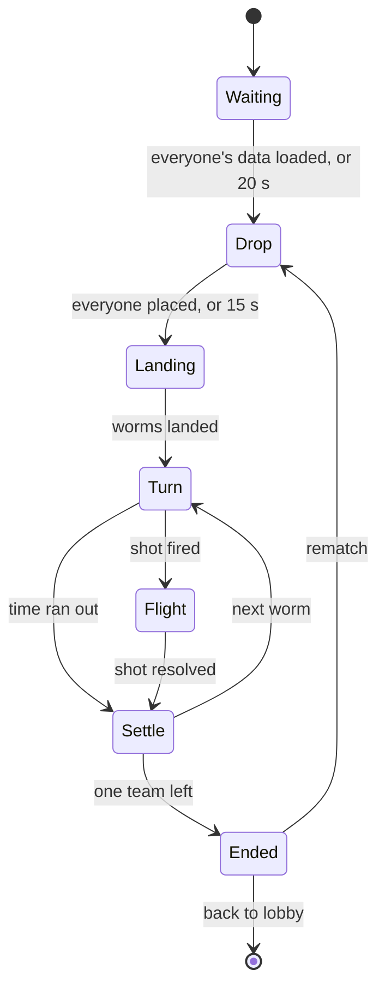

The modules that run on a **match server** (the `Match` map, in the match place). They live in
`src/modules/Main_Game/` of the code folder and are turned off on the `Lobby` map ([[Architecture#Place loader config]]).
All of them are built (phases P1 to P7 of the [[Roadmap]]); this page says what each one does and the numbers players
feel. **Each module's `_meta/README.md` is the source of truth** for its full API, remotes, settings and place setup.
Rules for every module: the code folder's `AGENTS.md` and `.claude/rules/` (`ume/structure.md`, `ume/events.md`,
`luau/*`, and the game's `game/practices.md`). What players see: [[Match modes & maps]], [[Controls & platforms]],
[[Arsenal]], [[Match screen]], [[Currencies & crates#Coins from a match]].

## Arsenal

| | |
|---|---|
| Runs on | Global (both maps: the lobby's loadout picker shows uses and cooldowns too) |
| Exposes | `I.G_Arsenal` |
| Data | `Data/Weapons/<ItemId>.lua`, `Data/Utilities/<ItemId>.lua` (shape: [[Data & networking#Arsenal rows]]) |

The combat numbers of the 14 weapons and 6 utilities, keyed by the same ids as their Inventory items, and their
models. It holds no state.

- `Get`, `GetAll`, `IsWeapon`, `IsUtility`; `GetDamage(itemId, distance, isShiny)` (linear from `DamageMax` at the
  center to `DamageEdge` at `BlastRadius`, ×`SHINY_DAMAGE_MULTIPLIER` 1.05 when shiny); `GetKnockback(class)`
  (`KNOCKBACK`: Small 20, Medium 45, High 70, VeryHigh 95, Extreme 130).
- **Models:** `GetModel`, `HasModel`, `GetProjectileModel`, `HasProjectileModel`, cached at start on both sides from
  `Assets/Arsenal/Models` and `Projectiles`. Each model is a hidden `RootPart` facing +X (at the grip of a held
  weapon, the centre of a thrown one) with a `Muzzle` attachment where its shot leaves it. `BURST_SHOTS` (`Snail`)
  lets a burst's shot have its own model. Still without one: Baseball Bat, One Punch, Low Gravity Potion, the
  Cluster bomb's bomblets.

**Done when:** `I.G_Arsenal.Get("Dynamite").DamageMax` prints 85 from the command bar, and a missing row warns once
at start.

## Arena

| | |
|---|---|
| Runs on | Server |
| Exposes | `I.Arena` |
| World | `Workspace.Ume.Arena` |

Owns the terrain, the liquids and the arena around it. How it works: [[Architecture#Terrain: authored parts carved by CSG]].

| Handler (`Scripts/Server/`) | Does |
|---|---|
| `Loader.lua` | Caches and checks every template at start; `Load(mapId)` clones one, places the `Plane`, notes the floor (`GetFloor`); registers the collision groups |
| `Carver.lua` | `BuildCutter` (one box per row of 1-stud squares in the blast) and `Carve`, by CSG |
| `Debris.lua` | Finds the groups a carve cut loose (bedrock on the floor and floating ledges hold), welds them, lets them fall and anchors them where they land |
| `Props.lua` | Collects the `Arena_Prop`s on load; after each carve cuts them, throws the freed pieces, drops props whose ground is gone |
| `Liquid.lua` | The half-stud water and lava grid at 8 fps, and `RaiseLiquid` for sudden death |

**API (`I.Arena`):** `Load`, `Carve(center, radius)`, `RaiseLiquid`, `GetBounds`, `GetMarkers`, `GetPlane`,
`GetLiquid(position)`, `GetHazard(position)` (`"Water"`, `"Lava"`, `"Bounds"` or nil), `IsFree(position, radius)`
(where a placed drop may go), `GetLandSpots(count, radius)` (where unplaced worms start: every top on every storey,
flat enough, out of liquid, `LAND_SPOT_GAP` 16 apart), `IsSettled()`. **Topic:** `Arena_Loaded (mapId)`. No remotes:
Roblox replicates the parts. **Admin commands:** `/arena load <map>`, `/arena carve <x> <y> <radius>`.

**Settings** (the main ones): `CARVE_CELL` 1, `CONTACT_MARGIN` 0.15, `FLOAT_MIN_AREA` 24, `LAND_SPOT_STEP` 2,
`LAND_SPOT_GAP` 16, `LAND_SPOT_MIN_NORMAL` 0.7, `COLLISION_GROUPS`, `SETTLE_SPEED` 0.5, `DEBRIS_SETTLE_TIME` 4,
`PROP_SUPPORT_DEPTH` 1.5, `PROP_BASE_HEIGHT` 0.6, `PROP_KNOCK_SPEED` 35, `PROP_KNOCK_SPIN` 6, `PROP_FADE_DELAY` 3,
`LIQUID_CELL` 0.5, `LIQUID_FPS` 8, `LIQUID_FALL` 6, `LIQUID_SPREAD` (water 12, lava 3), `LIQUID_PRESSURE` (water 8,
lava 2).

**Not built from the plan:** a map's gravity and lighting preset. **Unsure:** a still liquid surface can keep
half-stud bumps (it can't spread thinner than a cell).

**Done when:** `/arena carve -75 18 6` on Picnic Plains steps a crater in 1-stud stairs, a bridge cut at both ends
falls and lands, and water flows into a crater dug to the sea.

## Worms

| | |
|---|---|
| Runs on | Server, Client |
| Exposes | `I.Worms` (server: bodies and health; client: `Get`, `GetMine`) |
| World | `Workspace.Ume.Worms`, one Model per participant |

The worm bodies: spawning, health, damage, knockouts, ghosts, tags and gear.

- **A worm** is a Model named by its participant id (`P_<UserId>` for players, `B_<n>` for bots): an invisible ball
  `Root` 2.6 studs across in the `Worm` group (friction 1 at rest, 0 while walking), a `PlaneConstraint`, an
  `AlignOrientation` "Upright", a `LinearVelocity` "Walk", and the skin welded on, massless (only the Classic
  placeholder exists, in `Assets.Skins`).
- **Attributes:** `ParticipantId`, `UserId`, `DisplayName`, `Team`, `Color`, `IsBot`, `Health`, `MaxHealth`, `Alive`,
  `Ghost`, `Facing`, `Vip`, `DamageTaken`; Combat writes `HeldItem`, `AimAngle`, `AimPower`, `AimTime`; WormControl
  writes `CanMove`, `Stamina`, `Parachute`, `JetpackFuel`; Match writes `Active`.
- **API:** `Spawn`, `Damage` (a worm at 0 stays in play until Match knocks it out after the shot settles), `Heal`
  (never above 200), `Knockback` (the server must own the worm), `Kill`, `SetOwner`, `Clear`, `Get`, `GetAll`,
  `GetAlive`. **Topic:** `Worms_Died (participantId, cause, killerId?, itemId?)`.
- **Each Heartbeat** (server): hazards along each worm's path, then fall damage on landing (1 per stud above 10, 40
  at most; a worm stands when ground is within 0.4 studs under its ball).
- **Knockout:** a ghost, anchored, in the `Ghost` group, 0.6 see-through, floating 4 studs up over 1.5 s.
- **Client:** a `WormTag` on every worm (name in team colour, gold for VIP; level; a big health number over a bar
  coloured green → yellow → red by `HEALTH_*_COLOR`; the active worm's arrow), scaled by `I.ScreenScale.AddBillboard`;
  `DamagePop` numbers (with the `DamageNumbers` setting); and **gear** (`Gear.lua`, `GEAR`): the Parachute model 4.3
  studs over the ball while `Parachute` is set, the Jetpack 1.3 behind and 0.8 up while `JetpackFuel` is.
- **Not built:** animations (the skins have none), hurt sounds, voice lines.
- **Admin commands:** `/worms damage|heal <amount> [id]`, `/worms kill [id]`, `/worms push <x> <y> [id]`.

**Done when:** a test worm never leaves Z = 0, `/worms damage 50` drops it to 150 and pops "-50", and a worm dropped
into the water turns into a ghost and prints `Worms_Died … Water`.

## WormControl

| | |
|---|---|
| Runs on | Server, Client |
| Exposes | `I.WormControl` (server: `StartTurn`, `EndTurn`, `ApplyEffect`; client: `Hold` for touch buttons) |

Moving the active worm, and the movement utilities.

- **Turns:** `StartTurn` gives the worm's physics to its player's client, fills `Stamina` and sets `CanMove`; the
  client follows `CanMove`, so there are no remotes. `EndTurn` takes it back (server ownership, facing kept, the turn's
  effects cleared).
- **Client:** walks at `WALK_SPEED` 8 (A / D, arrows, left stick past 0.3, d-pad, the HUD's ◀ ▶), jumps at
  `JUMP_SPEED` 44 (about 5 studs) only from the ground, unlimited, climbs ledges up to 2 studs with a 16 studs/s push,
  and loses its grip while walking so it slides along walls. Bound at `ContextActionPriority.High`, sunk.
- **Server:** charges sideways movement to `Stamina` (20 studs a turn; at 0 the worm stops walking but keeps its turn
  and its jumps), and the speed check ([[Architecture#Worms and projectiles: Roblox physics, server-owned]]).
- **Effects** (`ApplyEffect`, called by Combat): `Parachute` (falls at 6 studs/s, no fall damage until it lands),
  `Jetpack` (3 s of fuel, climbing at 16 studs/s while jump is held), `Speed` (walks ×1.5 as fast and as far),
  `LowGravity` (0.4 of gravity). A shiny copy multiplies them by `SHINY_BOOST` (jetpack 1.2, speed 1.1, low gravity
  0.9, parachute 0.8).
- **Admin commands:** `/wormcontrol turn [id]`, `/wormcontrol end [id]`.

**Unsure:** touch and gamepad movement weren't tested in Studio.

**Done when:** on my turn my worm walks and jumps with no delay, stops after about 20 studs, and a command-bar
teleport of my worm on my client snaps it back within a second with the "moved too fast" warning.

## Combat

| | |
|---|---|
| Runs on | Server, Client, Global |
| Exposes | `I.Combat` (server; client: `SetAim`, `GetMuzzle`), `I.G_Combat` (both: launch math) |
| World | `Workspace.Ume.Combat` (projectiles, held weapons, aim circles, blast effects) |

Everything between "fire" and "the shot is over".

**The fire pipeline (server, `Fire.lua`):**

1. `Combat_Fire (player, itemId, angle, power, target?)` arrives (bots call `I.Combat.Fire` directly). It's refused
   unless the worm is the active one, the phase is `Turn`, the item is the Bazooka or in the match loadout with uses
   left and no cooldown, and `power` is 0–1.
2. Takes a use, starts the cooldown, `EndTurn`s the worm, publishes `Combat_ShotFired` (Match moves to `Flight`).
3. Runs the weapon's **behavior** (`Scripts/Server/Behaviors/<Kind>.lua`: `Rocket`, `Bouncer`, `Snail`, `Crawler`,
   `Homing`, `Roller`, `Hitscan`, `Melee`), each ending in `Explode` and/or `Hit` (`Blast.lua`).
4. When every projectile, bomblet and snail is done, publishes `Combat_ShotResolved (participantId, damage)`.

**Utilities** (`Combat_UseUtility`): heals through `I.Worms.Heal` (Bandage 40, Medkit 100; 45 and 110 shiny), the rest
through `I.WormControl.ApplyEffect`. Using one never ends the turn. **Uses and cooldowns** count per match
(`Uses.lua`), in the player's Replicator `Combat` (`Slots`, `Uses_<item>`, `Cooldown_<item>`).

**Aim, seen by everyone:** `ShowAim` writes the worm's `AimAngle`, `AimPower`, `AimTime` (0 once fired) and
`HeldItem`; the aiming client's unreliable `Combat_Aim` (10 a second) and bots go through it. `CHARGE_SECONDS` 1.6 is
how long a charge takes from none to full, and back (MatchHud and Bots read it).

**Client handlers** (`Scripts/Client/`):

| Handler | Draws |
|---|---|
| `Held.lua` | The active worm's weapon in its hands on every screen, from `HeldItem`: `HELD_FORWARD` 0.8 along the aim, `HELD_HEIGHT` −0.3, `HELD_DEPTH` 1.5 toward the camera, turning at `HELD_TURN_SPEED` 14, never upside down. On the aiming player's own screen it follows `SetAim` at once |
| `Flight.lua` | Each projectile part as its model (`GetProjectileModel`), hiding the server's placeholder ball; rockets point along their flight, thrown weapons turn with their ball, the spider bomb stays upright, snails face the camera. `PROJECTILE_STAND_INS` flies the Bazooka as the homing missile's missile |
| `Effects.lua` | From `Combat_Explosion`, `Combat_Tracer`, `Combat_Hit`: a flash, a fireball (gold when shiny), a light, fire, sparks and smoke (`BLAST_TEXTURES`, Roblox's own for now), up to `DEBRIS_MAX` 16 chunks of the hit ground in the `Chip` group (25–50 studs/s, 0.3–1 stud, `DEBRIS_LIFETIME` 2.5 s); a camera shake (`SHAKE_MAGNITUDE` 4, `SHAKE_SETTLE` 0.45, full at `FEEL_FULL_RADIUS` 10, none past `FEEL_RANGE` 90 studs from the view's middle); haptics (`Combat_BlastBig` from 0.6, `Combat_BlastSmall` from 0.15, `Combat_Hurt` on my worm; `Combat_Fire` is played by MatchHud) |

**Global (`I.G_Combat`):** `GetLaunchVelocity`, `GetWindAcceleration` (`WIND_ACCEL` 3), `PredictArc`, shared by bots
and the server.

**Other settings:** `MUZZLE_GAP` 0.8 (shots still leave just past the worm's ball, not from the drawn muzzle),
`SHOOTER_GRACE` 0.25, `MAX_PROJECTILE_TIME` 12, `UPWARD_BIAS` 0.5, `KNOCKBACK_EDGE` 0.5, `BULLET_CARVE` 0.75,
`BULLET_KNOCK_SHARE` 0.25, `BOMBLET_SPEED` 20–40, `SNAIL_SPEED` 6, `SNAIL_BITE` 0.3, `SNAIL_LIFETIME` 6,
`CONTACT_DISTANCE` 2.5, `ROLL_HOP_SPEED` 22, `MELEE_BOX` 4.

**Placeholders:** blast particles and the missing models above; no sounds yet.

**Done when:** each of the 14 weapons and 6 utilities does what its [[Arsenal]] row says in a Studio match against
a bot, uses count down in the loadout bar, and the kill feed names the right weapon for each knockout.

## Match

| | |
|---|---|
| Runs on | Server, Client |
| Exposes | `I.Match` (server, client) |
| World | `Workspace.Ume.Match` (attributes, `Participants`) |

The match: who plays, the phases, the turns, and how it ends.

| Handler (`Scripts/Server/`) | Does |
|---|---|
| `Phases.lua` | The main loop: loads the map **before** waiting for players (so it shows while they arrive), then `Play`. Runs `Play` in a `pcall`, and a match that can't play (no map, an error) sends everyone to the lobby. The drop: `Match_PickDrop (x, y)` keeps a spot only where `I.Arena.IsFree` lets a worm fit; the drop ends when every connected player placed, else after `DROP_SECONDS` 15; placed worms parachute from their spot, the rest start on `I.Arena.GetLandSpots` |
| `Roster.lua` | Builds participants from the metadata (or `STUDIO_METADATA`), counting a player as arrived only once `I.Player.Valid`; waits up to `WAIT_FOR_PLAYERS` 20 s; seats the arrived, fills the rest with bots (none in a custom match, nor a party match with `Difficulty = "None"`); team modes make Roblox teams (`TEAMS`), deathmatch gives each worm one of `FFA_COLORS` |
| `Turns.lua` | Team-by-team order, `TURN_SECONDS` 15, a new wind each turn (±`WIND_MAX` 10), rounds, the `TurnOrder` attribute (the worms that can play, in the order their next turn comes), sudden death: from `SUDDEN_DEATH_ROUND` 4 the liquid rises `SUDDEN_DEATH_RISE` 1 row (half a stud) every turn, from `SUDDEN_DEATH_FAST_ROUND` 8 by `SUDDEN_DEATH_FAST_RISE` 4 rows; settle (`SETTLE_HOLD` 0.5, `MAX_SETTLE` 8, `MAX_FLIGHT` 20) |
| `Placement.lua` | The order worms go out; the last team or worm standing first; team members share the team's place; a leaver is placed last among those still alive |
| `Connection.lua` | Leave (`Match_Leave`): the worm is knocked out (cause `Left`), then the player goes to the lobby. A drop keeps the seat for `REJOIN_SECONDS` 60 (`Match.Rejoin` in the profile). `SendToLobby` names the card ("Back to the lobby…") and, in the tutorial match, counts the tutorial as played (`I.Tutorial.CompleteMatch`) |
| `Rematch.lua` | `REMATCH_SECONDS` 20 of `Match_Rematch` votes; the voters play again on this server, everyone else goes. The tutorial skips it |
| `Stats.lua` | Per participant: damage, knockouts, rounds, best shot (its damage) |

**Client:** republishes the attributes as Topics (`Match_PhaseChanged`, `Match_TurnStarted`, `Match_MyTurn`), keeps
`IsMyTurn()` and `GetMyParticipantId()`, and the drop picker (`DropPicker.lua`: the marker follows the pointer or the
left stick at `DROP_STICK_SPEED` 40, faded where a worm doesn't fit; click, tap or A places it; others' `DropMarker`s
faded until placed).

**Studio:** `Host(players, metadata)` plays a match the lobby hands over on the `Studio` map.

**Done when:** a 4-worm Studio match runs waiting → drop → turns → a knockout → results; placing a spot in the sky
ends the drop at once; the sea stays put for rounds 1 to 3, rises a row each turn from round 4, four rows from round 8.

## Bots

| | |
|---|---|
| Runs on | Server |
| Exposes | `I.Bots` (`CreateParticipant(difficulty, number)`, `TakeTurn(participantId)`) |

AI participants for empty seats, solo and party matches, and the tutorial.

- **A bot** gets a name from `BOT_NAMES`, its difficulty's loadout (`LOADOUTS`: Easy Grenade and Shotgun; Medium adds
  Dynamite; Hard Dynamite, Cluster Bomb, Uzi, Homing Missile, Baseball Bat) and `DamageTaken`.
- **A turn:** thinks `THINK_TIME` 2.5–4 s, picks a target and a weapon (melee within `MELEE_RANGE` 5, guns within
  `GUN_RANGE` 40), searches angles and powers with `PredictArc` (every 6° and 0.1 power, 4 s of arc) until a shot
  lands near the target, then misses on purpose often enough to hit at `HIT_RATE` (Easy 30 %, Medium 60 %, Hard
  85 %, Tutorial 0). It holds its weapon, swings its crosshair from level to the shot over `AIM_TIME` 1.5 s, charges
  as a player would (guns and melee skip it), all shown through `ShowAim` every `AIM_STEP` 0.1 s, and fires through
  `I.Combat.Fire`.
- **Tutorial bot:** aims beside the player, never hits, and takes ×3 damage (`DAMAGE_TAKEN`), so two Bazooka hits
  (35 each) knock out its 200 health.

**Done when:** a solo Hard match in Studio: the bot hits most shots; an Easy bot misses most; both aim where the
player can see before firing.

## MatchCamera

| | |
|---|---|
| Runs on | Client |
| Uses | `I.Worms`, `I.Buff` (the `FOV` buff), `I.PlayerSettings` (`CameraFollowsShot`) |

The side-on camera, scriptable, looking along −Z from `DISTANCE` 110 with `FOV` 30, inside the Bounds marker. It
follows a flying shot (parts with the `Projectile` attribute) while `CameraFollowsShot` is on, else the active worm,
else the local player's worm, else the arena's middle (`FOLLOW_SPEED` 6). Panning: right-mouse drag, two fingers, or
the right stick while LT is held (`STICK_PAN_SPEED` 60); the pan resets when it follows another worm. Zoom: the wheel
(not over a scrolling gui) and a pinch, `ZOOM_MIN` 45 to `ZOOM_MAX` 200 studs, `ZOOM_STEP` 0.15 a notch,
`ZOOM_SPEED` 10; it stays for the match. It sets the `FOV` buff's `Standard` base instead of writing
`Camera.FieldOfView`, so an open window still widens the view 5°, and updates at the `Camera` render priority so
Combat's shakes land on top. **Not built:** panning at the screen's edge, a gamepad zoom, zooming out to fit wide
maps.

**Done when:** in a Studio match the camera never shows the arena from an angle, follows a Bazooka shot to its
explosion, pans on all three inputs, and two wheel notches in take it from 110 to about 79.5 studs.

## MatchHud

| | |
|---|---|
| Runs on | Client |
| Guis | `MatchHud`, `Results` ([[Guis]]) |

Everything on the match screen, as described on [[Match screen]] and [[Controls & platforms]]. It shows while the
player is in the match (the `InMatch` Player attribute) and hides the guis in `HIDDEN_IN_MATCH` (`Currency`).

| Handler (`Scripts/Client/`) | Draws |
|---|---|
| `TopBar.lua` | Leave (asks first) and Music on ume's top bar; chat and the mic are Roblox's own |
| `Turn.lua` | The turn panel: "YOUR TURN!", or the active worm's name in its colour and the player's wait from `TurnOrder` ("YOU'RE NEXT!", "YOUR TURN IN 3 TURNS"); the timer, blank outside the `Turn` phase; the wind's strength; the stamina bar ("Stamina 70%") |
| `Aim.lua` | The crosshair `CROSSHAIR_DISTANCE` 9 studs from the worm (`CROSSHAIR_SIZE` 3), pointing at the mouse, finger or right stick; holding charges the power, bouncing none → full → none every `CHARGE_SECONDS`, drawn as `POWER_DOTS` 32 circles from the weapon's `Muzzle` to the crosshair (`POWER_DOT_SIZE` 0.5 → 2.1, `POWER_COLORS` yellow → red), both kept the same size on screen at any zoom; letting go fires; nothing fires by itself. Guns and melee fire on the press. Homing missile: a target first. Sends `Combat_Aim` every `AIM_SEND_INTERVAL` 0.1 s and draws other worms' aims (`AIM_SHOW_GRACE` 0.4, `AIM_SMOOTHING` 15). The power bar ("Power 60%") and the angle ("45°") |
| `LoadoutBar.lua` | The Bazooka's box plus one per slot: the icon, or the item's model in a ViewportFrame when it has none (`MODEL_FOV` 30, `MODEL_VIEW_DIRECTION`, `MODEL_PADDING` 1.15); uses left ("x3"); the selected box blue; keys 1–6 (`SLOT_KEYS`), clicks, taps, LB / RB; sends `Combat_Select` |
| `TouchControls.lua` | ◀ ▶ (bottom left) and Jump (bottom right) on phones and tablets, through `I.WormControl.Hold` |
| `KillFeed.lua` | `FEED_LINES` 4 lines for `FEED_SECONDS` 6, from `Match_KnockedOut`; a line too long for the feed's width gets two lines |
| `Panels.lua` | The waiting, drop and knocked-out blocks (Spectate, Leave) |
| `Results.lua` | The `Results` widget on `Match_Results`: the lineup of placings, my coins and XP, stats, Rematch with votes and time left, Back to lobby |

The emote wheel is the Cosmetics module's ([[Lobby & meta modules#Cosmetics]]); the tutorial's hints are Tutorial's.

**Done when:** every item on [[Match screen]] shows and works on PC, on a phone (Studio's device emulator) and with a
gamepad.

## MatchRewards

| | |
|---|---|
| Runs on | Server |
| Uses | `I.Match` (`Match_Ended`), `I.Currency`, `I.Progression`, `I.Statistic`, `I.G_Marketplace` |

Pays each human at the end of a match, from the tables on [[Currencies & crates#Coins from a match]].

- **Coins by kind:** `Public` deathmatch by player count and place (`DEATHMATCH_COINS`), team match by number of
  teams and place (`TEAM_COINS`, `TEAM_2V2_WIN` 75), `Solo` only a win (`SOLO_COINS` Easy 20, Medium 35, Hard 60),
  `Party` like a public deathmatch of its worm count, times `PARTY_NO_BOTS_SHARE` 0.5 without bots (rounded down),
  `Custom` and `Tutorial` nothing (the tutorial's 100 coins come from Tutorial).
- **Anti-farming:** the last 2 places are paid only after `ANTI_FARM_ROUNDS` 2 rounds or a knockout by another
  participant; leavers get nothing. **Double Coins** doubles.
- **XP:** `XP_PER_MATCH` 100 for the kinds in `XP_KINDS` (Public, Solo, Party, Custom).
- **Statistics:** `MatchesPlayed`, `Wins`, `Knockouts`, `DamageDealt`.
- Saves the profile before the results show, then sends each player `Match_Results (placements, stats, earned)`.

**Done when:** a Studio 4-player deathmatch pays 100 / 50 / 25 / 15 by place (15 only after 2 rounds), and the coins
show in the results.

::navbox{from="build"}
