<h1 align="center">Startup Order</h1>

Ume startup order from GameMode through <code>Ume.Bloom()</code>. Diagram below; staged loader and tasks in <code>src/core/game_instance/Start/</code>.

---

```mermaid
flowchart TB
  subgraph SRV_ENTRY["Server · GameMode"]
    ES(["Ume-Server.server.lua"])
  end

  subgraph CLI_ENTRY["Client · GameMode"]
    EC(["Ume-Client.client.lua"])
    EXPOSE_CLI[("Waiting for RS pointers + values · yields client")]
    EC --> EXPOSE_CLI
  end

  subgraph ACTORS["Actors"]
    direction LR
    ASRV["Server: Runs independently"]
    ACLI["Client: Runs independently"]
  end

  subgraph START_SHARED["Instance.Start"]
    REQ(["Require Start"])
    BLOOM(["Ume.Bloom()"])
    REQ --> BLOOM
  end

  ES --> REQ
  EXPOSE_CLI --> REQ

  subgraph CORE["Core Loading"]
    direction TB
    RG[["Studio: Replication Gate · yields client"]]
    SETUP["Loading:<br/>Services · Env Variables · Directories · Configs"]
    DS[("DataStore Access Check · yields Studio probe")]
    LIB[["Loading Libraries"]]
    RG --> SETUP
    SETUP -->|Server| DS
    DS -->|Server| LIB
    SETUP -->|Client| LIB
  end

  BLOOM -->|Server| SETUP
  BLOOM -->|Client| RG

  subgraph PL["Place Loader"]
    direction TB
    P_MAP["Fetching: Map Id, Map Metadata · may yield server"]
    P_DIRS["Updating PlaceLoader Directories"]
    P_LOBBY{"Temporal Lobby?"}
    P_TELEPORT(["Main Server Teleport"])
    P_BLOOM_END(["Bloom ends"])
    P_FUNCS[["Registering PlaceLoader functions"]]
    P_CLI["Updating: Map Id & Config"]
    P_MAP_LOADED["Map Loaded"]
    P_MAP --> P_DIRS --> P_LOBBY
    P_LOBBY -->|yes| P_TELEPORT --> P_BLOOM_END
    P_LOBBY -->|no| P_FUNCS
    P_FUNCS --> P_MAP_LOADED
    P_CLI --> P_MAP_LOADED
  end

  LIB -->|Server| P_MAP
  LIB -->|Client| P_CLI

  subgraph LOAD["Pointer & Config"]
    direction TB
    L1["Creating Instance Pointer"]
    L2[["Registering: I.OnStarted"]]
    L3C[["Registering: I.OnLoaded"]]
    L4["Live: Updating Config"]
    L1 --> L2
    L2 -->|Server| L4
    L2 -->|Client| L3C --> L4
  end

  P_MAP_LOADED -->|Server| L1
  P_MAP_LOADED -->|Client| L2

  subgraph MOD["Modules"]
    direction TB
    M_PREP["Preparing Modules"]
    M_STORE[("Storing Modules")]
    subgraph M_RUN["Running modules"]
      direction LR
      subgraph M_RUN_SRV["Server"]
        direction TB
        MR_S_GI["Global._init()"]
        MR_S_GS["Global._start()"]
        MR_S_SI["Server._init()"]
        MR_S_SS["Server._start()"]
        MR_S_GI --> MR_S_GS --> MR_S_SI --> MR_S_SS
      end
      subgraph M_RUN_CLI["Client"]
        direction TB
        MR_C_GI["Global._init()"]
        MR_C_GS["Global._start()"]
        MR_C_CI["Client._init()"]
        MR_C_CS["Client._start()"]
        MR_C_GI --> MR_C_GS --> MR_C_CI --> MR_C_CS
      end
    end
    subgraph M_CMD["AdminPanel tool scripts: Scripts/AdminPanel/CommandBar, then Scripts/AdminPanel/Dashboard"]
      direction LR
      subgraph M_CMD_SRV["Server, per tool"]
        direction TB
        MC_S_GI["Global._init()"]
        MC_S_SI["Server._init()"]
        MC_S_GS["Global._start()"]
        MC_S_SS["Server._start()"]
        MC_S_GI --> MC_S_SI --> MC_S_GS --> MC_S_SS
      end
      subgraph M_CMD_CLI["Client, per tool"]
        direction TB
        MC_C_GI["Global._init()"]
        MC_C_CI["Client._init()"]
        MC_C_GS["Global._start()"]
        MC_C_CS["Client._start()"]
        MC_C_GI --> MC_C_CI --> MC_C_GS --> MC_C_CS
      end
    end
    M_ONSTART[["Running: registered I.OnStarted callbacks"]]
    M_PREP --> M_STORE
    M_STORE -->|Server| MR_S_GI
    M_STORE -->|Client| MR_C_GI
    MR_S_SS --> MC_S_GI
    MR_C_CS --> MC_C_GI
    MC_S_SS --> M_ONSTART
    MC_C_CS --> M_ONSTART
  end

  L4 -->|Server| M_PREP
  L4 -->|Client| M_STORE

  subgraph PROT["Protect"]
    direction TB
    PR1["Hiding Server + Protected Scripts"]
  end

  subgraph FIN_SRV["Finishing · server"]
    direction TB
    F1[["Creating OnLoaded Remote Event"]]
    F2[["Listening for client finishing loading the framework"]]
    F_CLIENT_BOOL[["Creating client status BoolValue · async"]]
    F_SRV_LOAD[["Loading player data · running player events · async"]]
    F3["Studio: Creating the server manifest"]
    F4[("Parent Instance to ReplicatedStorage")]
    F5(["Framework Bloom Finished"])
    F1 --> F2 --> F3 --> F4 --> F5
  end

  subgraph FIN_CLI["Finishing · client"]
    direction TB
    FC1[["Listening for Player Loaded remote"]]
    FC_ONLOADED[["Running: I.OnLoaded callbacks · async"]]
    FC2[["Notifying server · ClientLoaded (remote)"]]
    FC3(["Framework Bloom Finished"])
    FC1 --> FC2 --> FC3
    FC1 -.->|async · OnClientEvent PlayerLoaded| FC_ONLOADED
  end

  classDef asyncMilestone fill:#e8f0fe,stroke:#3367d6,color:#153354
  classDef yieldStep fill:#fff8e6,stroke:#b8860b,color:#5c4300
  class FC_ONLOADED,F_CLIENT_BOOL,F_SRV_LOAD asyncMilestone
  class DS,P_MAP,EXPOSE_CLI,RG yieldStep

  M_ONSTART -->|Server| PR1
  M_ONSTART -->|Client| FC1
  PR1 --> F1

  FC2 -.->|async · ClientLoaded fired| F2
  F2 -.->|async · OnServerEvent handler| F_CLIENT_BOOL
  F_CLIENT_BOOL -.->|async · game / systems| F_SRV_LOAD
  F_SRV_LOAD -.->|async · FireClient PlayerLoaded| FC_ONLOADED
```

## AdminPanel tool scripts

After every module has run `_init` and `_start`, `tasks/modules.lua` runs each module's admin tool scripts, one tool at a time in `ADMIN_PANEL_TOOLS` order (`CommandBar`, then `Dashboard`):

1. While preparing, the server renames the scope scripts in `Scripts/AdminPanel/<Tool>/` to `Ume || <Scope> - <Module>_<Tool>`.
2. Each side stores the ones for its side, per tool.
3. The loader runs `_init` on every module in load order (Global, then the side's script), then `_start` the same way, and sets `I.Modules["Initialized_<Tool>"]` and `I.Modules["Started_<Tool>"]`. Execution times are labelled `<Module>::<Tool>.<Scope>._init`.

The loader names the two tool folders itself, as it named `Scripts/Command` before (decided on 2026-10-26 over a configurable list of passes, which would cost more code for two folders). A third tool means adding its name to `ADMIN_PANEL_TOOLS`.
